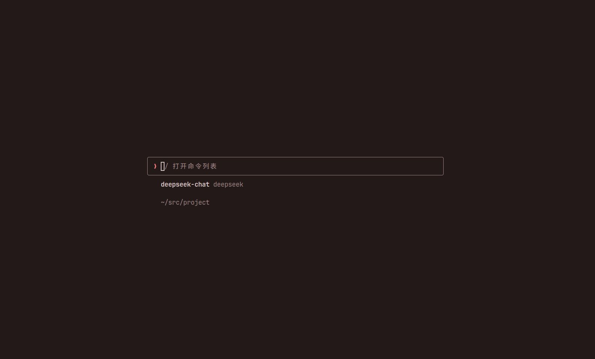
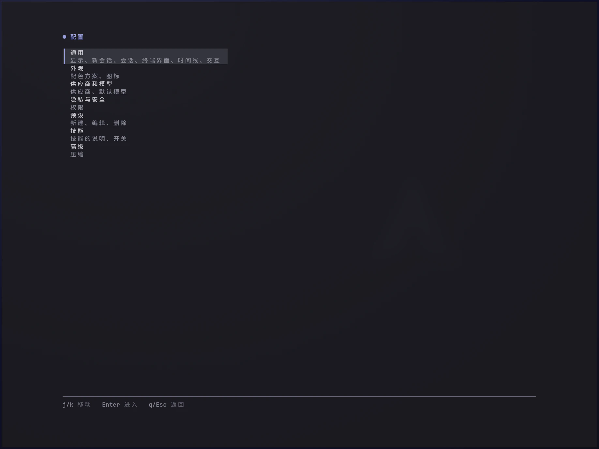
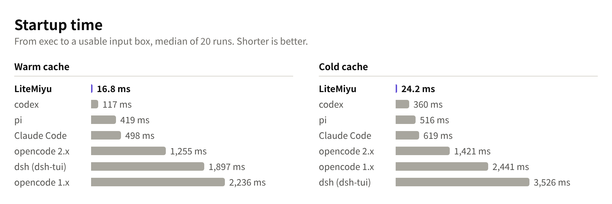
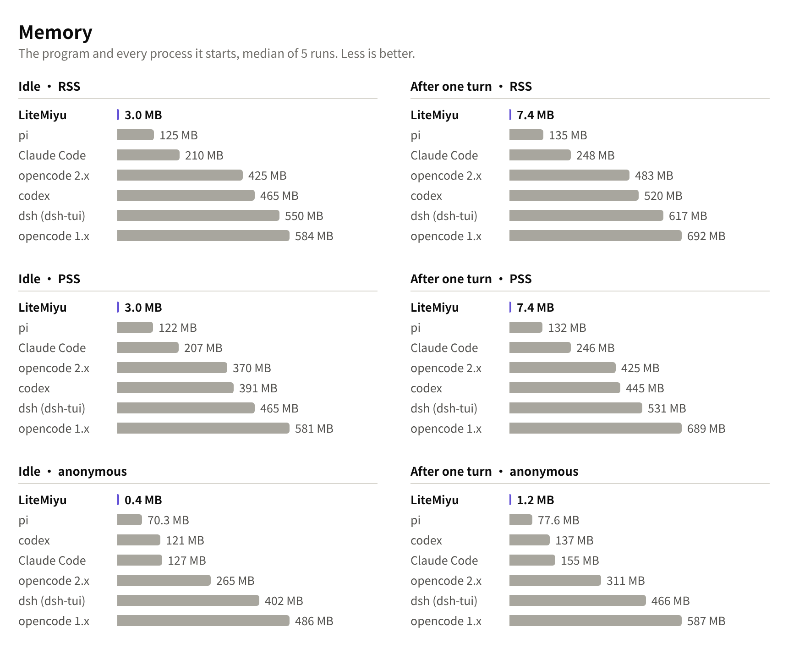
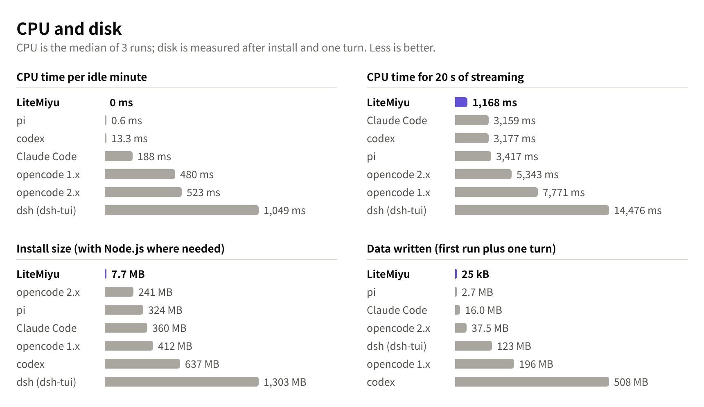

  

  English | <a href="README.zh-CN.md">简体中文</a>

# LiteMiyu

> This document was generated by Claude Fable 5.2 from Anthropic.

LiteMiyu is a terminal agent harness distilled from [Miyu](https://github.com/miyu-agent/miyu). It takes lightness as far as it can go without giving up the experience. The whole thing is one static program under 8 MB with no dependencies: put it on your `PATH` and it works. It uses about 3 MB of memory when idle and starts in under 20 milliseconds. Subagents, cross-session messaging, loops, scheduled continuation, skills, MCP and memory all work out of the box. All of the code is written by frontier AI.

When your computer is in trouble and no other agent will start, LiteMiyu can still start in rescue mode and help you fix it.

## Screenshots

**In a conversation**

More screenshots (new session, settings)

 

**New session**

**Settings**

## Performance

The charts below compare LiteMiyu with mainstream harnesses on the same machine under the same conditions, each running its own terminal interface. LiteMiyu is the lowest in all four areas: startup time, memory, CPU and disk.

<picture>
  <source media="(prefers-color-scheme: dark)" srcset="docs/assets/perf-startup-en-dark.webp">
  
</picture>

<picture>
  <source media="(prefers-color-scheme: dark)" srcset="docs/assets/perf-memory-en-dark.webp">
  
</picture>

<picture>
  <source media="(prefers-color-scheme: dark)" srcset="docs/assets/perf-cpu-disk-en-dark.webp">
  
</picture>

How the test was run

 

**Programs**

Each program is the latest stable release on the day of the test (2026-11-20), and each is tested in its full-screen terminal interface.

| Program | Version | Installed with |
|---|---|---|
| LiteMiyu | 2026.11.0-pre.1 (commit `e2502ba`) | The static Linux x86_64 program, built the way releases are built |
| Claude Code | 2.1.329 | `npm install @anthropic-ai/claude-code` |
| codex | 0.171.0 | `npm install @openai/codex` |
| pi | 1.5.2 | `npm install @earendil-works/pi-coding-agent` |
| dsh | 0.2.2-rc.5, with dsh-tui 0.20.2 as its interface | `npm install @deepseek-ai/dsh @deepseek-harness-tui/dsh-tui` |
| opencode 1.x | 1.19.6 | `npm install opencode-ai` |
| opencode 2.x | 2.3.2 | The archive from its GitHub releases page |

dsh has no terminal interface of its own, so the third-party dsh-tui is used. opencode maintains two release lines, so both are tested.

**Test machine**

AMD Ryzen 7 8745HS (8 cores, 16 threads), 23 GB of memory, Arch Linux, kernel 7.2, btrfs.

**Shared conditions**

- Each program has its own home directory, data directory and private `/tmp`, and cannot see the others' files.
- Every program talks to the same fake model service on the local machine, so each receives the same answer at the same speed. No real model service is used.
- The measured runs have no access to the outside network.
- Only three things are changed for each program: pointing it at the fake model, skipping first-run onboarding, and turning off auto-update and telemetry. Everything else is the factory default, for LiteMiyu as well.
- The terminal is 120 columns by 40 rows.
- Every run starts the program in a new cgroup and accounts resources for the whole cgroup, so child processes and background processes count towards the program that started them.
- Every run is a fresh process. Background processes left from the previous run are ended first.
- Each program is initialised once (it finishes its first-run work and answers one message). That run is not counted, so every result is for a run that is not the first.
- Runs only start when the machine is idle. If other processes use more than one core on average during a run, the result is discarded and the run is repeated.
- Each item is measured round by round, and in each round every program runs once in turn.

**How each item is measured**

| Item | Method | Runs |
|---|---|---|
| Startup time | Timed from the moment the program starts executing until the input box accepts and shows typed characters (`ready`). The moment the terminal receives the first byte is also recorded (`first`). | 20 each for warm and cold cache; median and P90 |
| Warm cache | The program's files are already in the page cache. Before every counted start, the program is started once without counting. | |
| Cold cache | Before every start, all files in the program's install directory, its data directory and the Node.js it uses are evicted from the page cache, and the eviction is verified. | |
| Memory, idle | Start the program and do nothing; wait 15 seconds after the input box appears. | 5; median |
| Memory, after one turn | Send one message. The fake model answers, calls a command-running tool once, then answers again. Wait 15 seconds after the answer ends. | 5; median |
| CPU, idle | Wait 15 seconds after the input box appears, then take the CPU time used in the next 60 seconds. | 3; median |
| CPU, streaming | The fake model streams 1000 tokens at a fixed 50 tokens per second, about 20 seconds. The CPU time is taken from pressing Enter until one second after the model finishes. | 3; median |
| Disk, install size | The sum of file sizes in the install directory after installation, including every dependency the package brings. Programs that need Node.js also have the size of Node.js 26.13.1 added. | |
| Disk, data | Every file the program writes in its home directory, `/tmp` and working directory after initialisation plus one turn, including components it downloads on first run. | |

Memory is the sum of `/proc/<pid>/smaps_rollup` over every process in the cgroup, in four measures:

| Measure | Meaning |
|---|---|
| RSS | Physical memory the processes occupy, including memory shared with other processes |
| PSS | The same, with shared memory divided among the processes that share it |
| Private | Memory that belongs to these processes alone and is fully returned when they exit |
| Anonymous | Memory not backed by any file (heap, stack and so on); it can only stay in memory or go to swap |

**All the numbers**

Startup, in milliseconds:

| Program | warm first | warm ready (P90) | cold ready (P90) | CPU until ready |
|---|---:|---:|---:|---:|
| **LiteMiyu** | 11.1 | 16.8 (20.6) | 24.2 (29.3) | 14.2 |
| Claude Code | 286 | 498 (558) | 619 (654) | 564 |
| codex | 80.5 | 117 (145) | 360 (382) | 120 |
| pi | 402 | 419 (445) | 516 (580) | 555 |
| dsh (dsh-tui) | 1,011 | 1,897 (1,936) | 3,526 (3,628) | 2,671 |
| opencode 1.x | 699 | 2,236 (2,281) | 2,441 (2,531) | 4,109 |
| opencode 2.x | 188 | 1,255 (1,316) | 1,421 (1,438) | 3,193 |

Memory, in MB:

| Program | idle RSS | idle PSS | idle private | idle anon | used RSS | used PSS | used private | used anon | procs / threads |
|---|---:|---:|---:|---:|---:|---:|---:|---:|---:|
| **LiteMiyu** | 3.0 | 3.0 | 3.0 | 0.4 | 7.4 | 7.4 | 7.4 | 1.2 | 1/2 → 1/3 |
| Claude Code | 210 | 207 | 207 | 127 | 248 | 246 | 246 | 155 | 1/19 → 1/21 |
| codex | 465 | 391 | 317 | 121 | 520 | 445 | 371 | 137 | 3/76 → 4/98 |
| pi | 125 | 122 | 121 | 70.3 | 135 | 132 | 132 | 77.6 | 1/11 → 1/11 |
| dsh (dsh-tui) | 550 | 465 | 425 | 402 | 617 | 531 | 492 | 466 | 3/25 → 3/25 |
| opencode 1.x | 584 | 581 | 580 | 486 | 692 | 689 | 688 | 587 | 1/30 → 1/35 |
| opencode 2.x | 425 | 370 | 319 | 265 | 483 | 425 | 373 | 311 | 2/44 → 3/48 |

CPU and disk:

| Program | idle CPU (ms/min) | idle wakeups (/min) | CPU for 20 s streaming (ms) | install (MB) | with Node.js (MB) | data (MB) |
|---|---:|---:|---:|---:|---:|---:|
| **LiteMiyu** | 0 | 0 | 1,168 | 7.7 | — | 0.02 |
| Claude Code | 188 | 3,256 | 3,159 | 360 | — | 16.0 |
| codex | 13.3 | 212 | 3,177 | 423 | 637 | 508 |
| pi | 0.6 | 6 | 3,417 | 110 | 324 | 2.7 |
| dsh (dsh-tui) | 1,049 | 7,595 | 14,476 | 1,089 | 1,303 | 123 |
| opencode 1.x | 480 | 6,419 | 7,771 | 412 | — | 196 |
| opencode 2.x | 523 | 6,214 | 5,343 | 241 | — | 37.5 |

**How to read these numbers**

- They are only meaningful when compared with each other, on the same machine and under the same conditions.
- The test machine's frequency governor favours power saving. A program started on an idle machine does not get a high clock speed at first, so absolute startup times are larger than they would be elsewhere, and faster programs are affected more. For reference, a minimal program that only echoes its input needs 7.8 ms under this method. On the development machine, LiteMiyu shows its input box 2.6 ms after starting.
- `ready` means that the input box accepts and shows typed characters. Some programs are still preparing in the background at that moment, and a message sent then waits a little before it is handled.
- When an answer is longer than one screen, LiteMiyu keeps the view at the start of the answer so you can read from the top, while the others follow the newest line. A separate run that makes LiteMiyu follow to the end used 1,168 ms of CPU while streaming, the same as the default.
- The cold cache only evicts file contents. File system metadata and the system's shared libraries stay cached, so it is warmer than a freshly booted machine.

The scripts, the raw record of every run and a more detailed description are in [`bench/rivals/`](bench/rivals/). The detailed description is in Chinese.

## Getting started

These pages cover installation and basic use.

- [Quick start](docs/en/guide/quickstart.md)
- [Full documentation](docs/README.md)

Ways to install:

| System | Install |
|---|---|
| Arch Linux | `paru -S litemiyu-bin` |
| macOS (Apple silicon), or Linux with Homebrew | `brew install miyu-agent/tap/litemiyu` |
| Linux or macOS with Node.js installed | `npm install -g litemiyu` |
| Debian, Ubuntu, Fedora, RHEL, openSUSE | Download the deb or rpm package from the [releases page](https://github.com/miyu-agent/litemiyu/releases/latest) |
| Other Linux distributions, macOS | Download the archive from the [releases page](https://github.com/miyu-agent/litemiyu/releases/latest), unpack it, and put `litemiyu` on your `PATH` |

The full steps for each method, checksum verification, upgrading and uninstalling are in [Install](docs/en/guide/install.md).

## License

AGPL-3.0-or-later; see `LICENSE`. LiteMiyu's code is derived from Miyu, which is also released under the AGPL.

The third-party libraries statically linked into the program, and their licenses, are listed in `THIRD-PARTY-LICENSES.txt`.

The names of providers and models are trademarks of their respective owners. LiteMiyu only fetches the model catalog from models.dev at run time and caches it locally; the catalog is not distributed with the program. Using these names does not imply that their owners endorse or sponsor LiteMiyu. The same applies to the names of the other programs in the comparison above.
