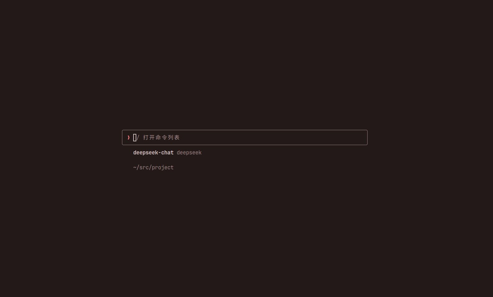
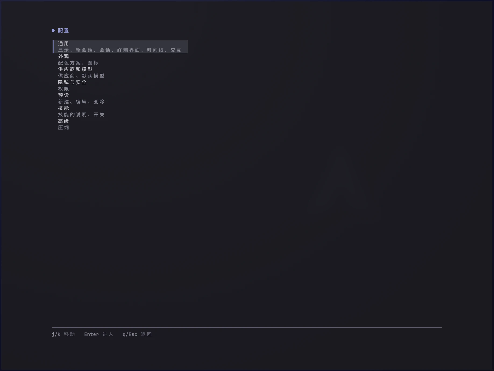
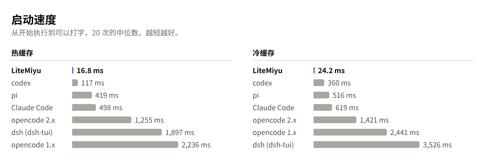
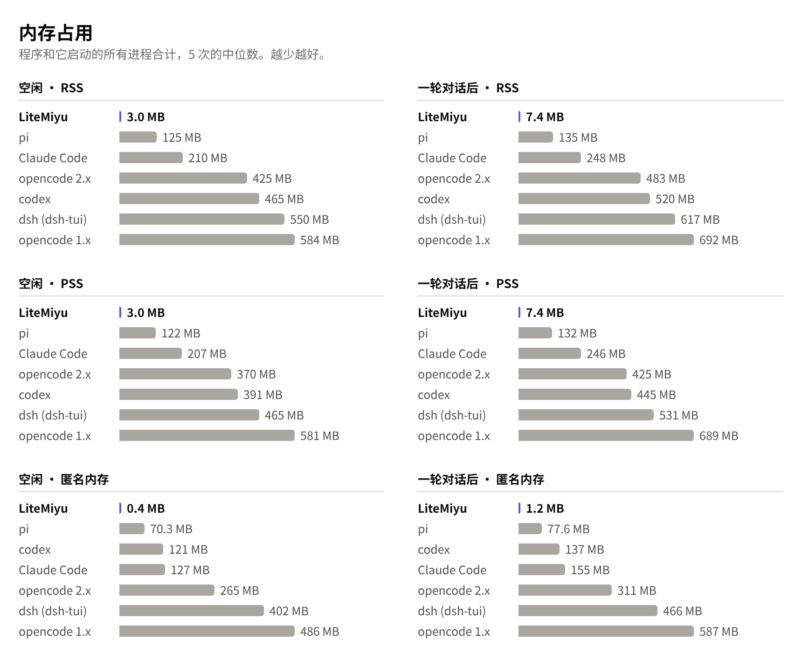
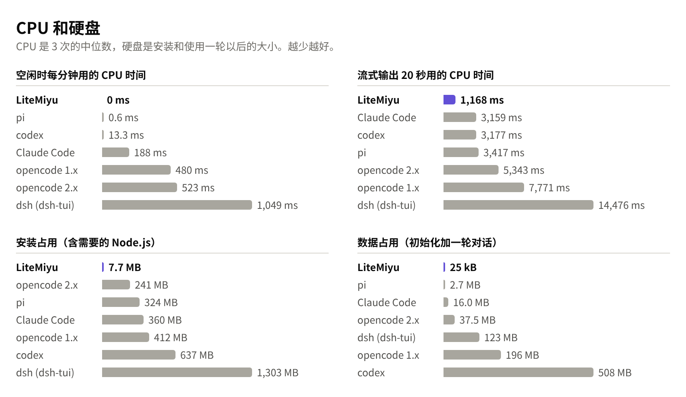

  <a href="README.md">English</a> | 简体中文

# LiteMiyu

> 本文档由 Anthropic 的 Claude Fable 5.2 生成。

LiteMiyu 是从 [Miyu](https://github.com/miyu-agent/miyu) 提炼出来的终端 Agent Harness（智能体框架），在轻量化这方面做到了极致，并且没有牺牲使用体验。整个软件只有一个不到 8 MB 的静态程序，没有任何依赖，放进 `PATH` 就能使用；空闲时占用约 3 MB 内存，十几毫秒就能启动。子代理、跨会话通讯、Loop、定时触发、Skills、MCP、记忆等基本功能开箱即用。所有代码由世界前沿 AI 编写。

电脑出了问题、别的 Agent 都启动不了的时候，LiteMiyu 还可以用应急模式启动，帮你把电脑修好。

## 预览图片

**对话中**

更多截图（新会话、设置）

 

**新会话**

**设置**

## 极致性能

下面是 LiteMiyu 和主流 Harness 在同一台机器、同一套条件下的对比，全部使用各自的终端界面。LiteMiyu 在启动速度、内存占用、CPU 占用、硬盘占用这四个方面都是最低的。

<picture>
  <source media="(prefers-color-scheme: dark)" srcset="docs/assets/perf-startup-zh-dark.webp">
  
</picture>

<picture>
  <source media="(prefers-color-scheme: dark)" srcset="docs/assets/perf-memory-zh-dark.webp">
  
</picture>

<picture>
  <source media="(prefers-color-scheme: dark)" srcset="docs/assets/perf-cpu-disk-zh-dark.webp">
  
</picture>

测试流程和标准

 

**参加对比的程序**

每一家都安装测试当天（2026-11-20）最新的正式版，并且都用终端全屏界面来测。

| 程序 | 版本 | 安装方式 |
|---|---|---|
| LiteMiyu | 2026.11.0-pre.1（提交 `e2502ba`） | 按发行的方式编译出的 Linux x86_64 静态程序 |
| Claude Code | 2.1.329 | `npm install @anthropic-ai/claude-code` |
| codex | 0.171.0 | `npm install @openai/codex` |
| pi | 1.5.2 | `npm install @earendil-works/pi-coding-agent` |
| dsh | 0.2.2-rc.5，界面是 dsh-tui 0.20.2 | `npm install @deepseek-ai/dsh @deepseek-harness-tui/dsh-tui` |
| opencode 1.x | 1.19.6 | `npm install opencode-ai` |
| opencode 2.x | 2.3.2 | GitHub 发行页的压缩包 |

dsh 自己没有终端界面，这里使用的是第三方的 dsh-tui。opencode 同时维护着两条版本线，所以两条都测了。

**测试机**

AMD Ryzen 7 8745HS（8 核 16 线程），23 GB 内存，Arch Linux，内核 7.2，文件系统是 btrfs。

**共同的条件**

- 每一家有自己的家目录、数据目录和私有的 `/tmp`，互相看不到对方的文件。
- 每一家都连接本机上的同一个假模型服务，收到的回答内容和输出速度完全相同。测试不使用任何真实的模型服务。
- 正式测量时不连接外网。
- 每一家只修改三件事：连接假模型、跳过首次引导、关闭自动更新和遥测。其余全部使用出厂默认设置，LiteMiyu 也一样。
- 终端是 120 列、40 行。
- 每一次运行，被测的程序都启动在一个新建的 cgroup 里，资源按整个 cgroup 计算，所以程序启动的子进程和后台进程都算在它自己头上。
- 每一次都是全新的进程，上一次留下的后台进程会先全部结束。
- 每一家先初始化一次（完成首次运行要做的事并发一句话），这一次不计入结果，所以测到的都是“不是第一次运行”的情况。
- 机器空闲时才测量。运行期间如果其他进程平均占用了 1 个核以上，这一次的结果作废并重新测量。
- 每一项都是一轮一轮地做，每一轮里各家依次运行一次。

**每一项是怎么测的**

| 项目 | 测法 | 次数 |
|---|---|---|
| 启动速度 | 从程序开始执行的那一刻计时，到输入框能接收并显示打的字为止（`ready`）。另外记录终端收到第一个字节的时刻（`first`）。 | 热缓存、冷缓存各 20 次，取中位数和 P90 |
| 热缓存 | 程序文件已经在内存的页缓存里。每一次计入结果的启动之前，都先启动一次不计入的。 | |
| 冷缓存 | 每一次启动之前，把这一家的安装目录、数据目录和它用到的 Node.js 的所有文件从页缓存里移出去，并确认已经移出。 | |
| 内存 · 空闲 | 启动以后什么都不做，输入框出现后再等 15 秒。 | 5 次，取中位数 |
| 内存 · 一轮对话后 | 发一句话，假模型回一段话、调用一次执行命令的工具、再回一段话。回答结束后等 15 秒。 | 5 次，取中位数 |
| CPU · 空闲 | 输入框出现后等 15 秒，再看接下来 60 秒用掉的 CPU 时间。 | 3 次，取中位数 |
| CPU · 流式输出 | 假模型以每秒 50 个 token 的固定速度流式回答 1000 个 token，约 20 秒。测的是从按下回车到模型说完以后 1 秒用掉的 CPU 时间。 | 3 次，取中位数 |
| 硬盘 · 安装占用 | 安装完成后安装目录里文件大小之和，连同包带下来的全部依赖。需要 Node.js 的程序加上 Node.js 26.13.1 的大小。 | |
| 硬盘 · 数据占用 | 初始化加一轮对话以后，这一家在家目录、`/tmp` 和工作目录里写下的全部文件，包括它第一次运行时自己下载的组件。 | |

内存取 cgroup 里所有进程的 `/proc/<pid>/smaps_rollup` 之和，共四个口径：

| 口径 | 含义 |
|---|---|
| RSS | 进程实际占用的物理内存，包括和别的进程共享的部分 |
| PSS | 共享的内存按共享它的进程数平摊以后的占用 |
| 私有内存 | 只属于这个进程的内存，进程退出以后可以全部收回 |
| 匿名内存 | 不对应任何文件的内存（堆、栈等），只能留在内存里或者写进交换分区 |

**全部数字**

启动，单位是毫秒：

| 程序 | 热缓存 first | 热缓存 ready（P90） | 冷缓存 ready（P90） | 到 ready 用的 CPU |
|---|---:|---:|---:|---:|
| **LiteMiyu** | 11.1 | 16.8 (20.6) | 24.2 (29.3) | 14.2 |
| Claude Code | 286 | 498 (558) | 619 (654) | 564 |
| codex | 80.5 | 117 (145) | 360 (382) | 120 |
| pi | 402 | 419 (445) | 516 (580) | 555 |
| dsh (dsh-tui) | 1,011 | 1,897 (1,936) | 3,526 (3,628) | 2,671 |
| opencode 1.x | 699 | 2,236 (2,281) | 2,441 (2,531) | 4,109 |
| opencode 2.x | 188 | 1,255 (1,316) | 1,421 (1,438) | 3,193 |

内存，单位是 MB：

| 程序 | 空闲 RSS | 空闲 PSS | 空闲私有 | 空闲匿名 | 对话后 RSS | 对话后 PSS | 对话后私有 | 对话后匿名 | 进程 / 线程 |
|---|---:|---:|---:|---:|---:|---:|---:|---:|---:|
| **LiteMiyu** | 3.0 | 3.0 | 3.0 | 0.4 | 7.4 | 7.4 | 7.4 | 1.2 | 1/2 → 1/3 |
| Claude Code | 210 | 207 | 207 | 127 | 248 | 246 | 246 | 155 | 1/19 → 1/21 |
| codex | 465 | 391 | 317 | 121 | 520 | 445 | 371 | 137 | 3/76 → 4/98 |
| pi | 125 | 122 | 121 | 70.3 | 135 | 132 | 132 | 77.6 | 1/11 → 1/11 |
| dsh (dsh-tui) | 550 | 465 | 425 | 402 | 617 | 531 | 492 | 466 | 3/25 → 3/25 |
| opencode 1.x | 584 | 581 | 580 | 486 | 692 | 689 | 688 | 587 | 1/30 → 1/35 |
| opencode 2.x | 425 | 370 | 319 | 265 | 483 | 425 | 373 | 311 | 2/44 → 3/48 |

CPU 和硬盘：

| 程序 | 空闲 CPU（毫秒/分钟） | 空闲唤醒（次/分钟） | 流式输出 20 秒的 CPU（毫秒） | 安装本体（MB） | 加上 Node.js（MB） | 数据（MB） |
|---|---:|---:|---:|---:|---:|---:|
| **LiteMiyu** | 0 | 0 | 1,168 | 7.7 | — | 0.02 |
| Claude Code | 188 | 3,256 | 3,159 | 360 | — | 16.0 |
| codex | 13.3 | 212 | 3,177 | 423 | 637 | 508 |
| pi | 0.6 | 6 | 3,417 | 110 | 324 | 2.7 |
| dsh (dsh-tui) | 1,049 | 7,595 | 14,476 | 1,089 | 1,303 | 123 |
| opencode 1.x | 480 | 6,419 | 7,771 | 412 | — | 196 |
| opencode 2.x | 523 | 6,214 | 5,343 | 241 | — | 37.5 |

**这些数字怎么读**

- 这些数只在同一台机器、同一套条件下互相比较才有意义。
- 测试机的调频策略偏向省电，机器空闲时启动的程序一开始拿不到高主频，所以启动时间的绝对值偏大，启动越快的程序受到的影响越明显。作为参照，一个只把输入照原样显示的最小程序在这套测法下也需要 7.8 毫秒。在开发用的机器上，LiteMiyu 启动到出现输入框是 2.6 毫秒。
- `ready` 的含义是“输入框能接收并显示打的字”。有的程序在这个时刻还在后台做准备，这时发出去的话要稍等一下才会被处理。
- LiteMiyu 在回答超过一屏的时候，会让画面停在回答的开头，方便从头读；其他几家会一直跟到最新的一行。让 LiteMiyu 也跟着滚到结束另外测了一组，流式输出用掉的 CPU 时间是 1,168 毫秒，和默认的没有差别。
- 冷缓存只移出了文件的内容，文件系统的元数据和系统自带的共享库仍然在缓存里，所以比“刚开机”要热一些。

测试脚本、每一次运行的原始记录和更详细的说明见 [`bench/rivals/`](bench/rivals/)。

## 快速上手

请阅读以下文章快速了解安装方法和基本的使用方法。

- [快速上手](docs/zh/guide/quickstart.md)
- [完整文档](docs/README.md)

目前公开发布的是预发布版。[发行版页面](https://github.com/miyu-agent/litemiyu/releases)上有每个系统的压缩包，Linux 另有 deb、rpm 和 Arch 的包，安装方法请阅读[安装](docs/zh/guide/install.md)。

## 许可证

AGPL-3.0-or-later，见 `LICENSE`。LiteMiyu 的代码派生自 Miyu，Miyu 同样以 AGPL 发布。

程序里静态链接的第三方库和它们各自的许可证见 `THIRD-PARTY-LICENSES.txt`。

供应商、模型的名称是各自所有者的商标，归各自所有者。LiteMiyu 只在运行时从 models.dev 获取模型目录并缓存在本机，不随程序发布；用到它们不表示这些所有者认可或赞助 LiteMiyu。上面的对比测试里提到的其他软件，名称同样归各自所有者。
