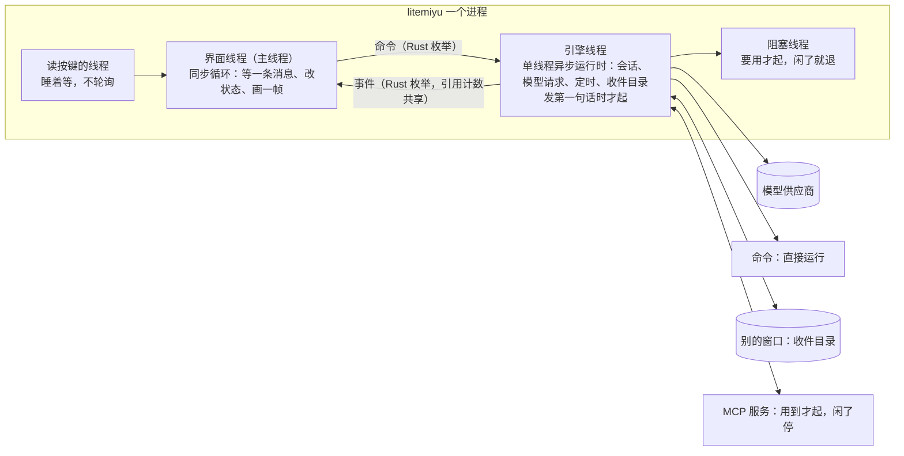

# LiteMiyu 设计

> 本文档由 Anthropic 的 Claude Opus 5.5 生成。

这一页说明 LiteMiyu 现在是怎么设计的：它要守的六条红线、支持哪些系统、有哪些功能、程序内部怎么分工、数据放在哪里，以及占用是怎么量、怎么守的。怎么安装和使用写在 [README](../README.md) 里。

## 一、LiteMiyu 是什么

LiteMiyu 是一个 Agent Harness（智能体框架）：在终端里全屏运行，你和 AI 对话，AI 可以读写文件、运行命令、开子会话帮你做事。它从 [Miyu](https://github.com/miyu-agent/miyu) 的核心和终端界面里削出来，代码派生自 Miyu 核心的 `c7dbc259e` 和终端界面的 `0847e1b0` 两个提交，许可证同样是 AGPL-3.0-or-later。

它和 Miyu 有三处根本的不同：

- **一个进程、一个程序文件。** 核心和界面编在同一个程序里，开一个终端窗口就是一个完整的进程，关掉窗口就全部停止。因此 Miyu 里核心和界面之间的协议、套接字、令牌、订阅、断线重连这一整层都不存在。
- **只支持类 Unix 系统**：Linux、macOS 和 BSD。代码里没有 Windows 的分支和依赖；在 Windows 上可以通过 WSL2 使用 Linux 的版本。
- **数据完全独立。** LiteMiyu 有自己的数据目录和配置格式，不读写 Miyu 的数据，也不做迁移。唯一的例外是配置界面里的「从 Miyu 导入」（第六节第 13 条），它只读取 Miyu 的配置文件。

LiteMiyu 也可以在 Miyu 起不来的时候（磁盘满了、配置坏了、核心崩溃）当作兜底：`litemiyu --rescue` 进入应急模式，什么都不写盘、不依赖配置文件，只要程序能启动、网络通就能用（第六节第 16 条）。

## 二、六条红线

红线是这个项目的硬约束。一个功能留不留、怎么做，先看它会不会让占用越过红线。目标是「麻雀虽小，五脏俱全」：该有的功能都有，每一样都做到最小。

| # | 红线 | 上限 | 对照 |
|---|---|---|---|
| 1 | 空闲时的 PSS：能打字、还没发过消息 | 3 MB | 对比测试里另一家 harness 是 17.1 MB，Miyu 约 45 MB |
| 2 | 发过消息、闲下来以后的 PSS（短会话，连 HTTPS 的供应商，缓存里有模型目录） | 6 MB | |
| 3 | 十个空闲窗口加起来的 PSS | 17.1 MB（上面那一家一个窗口的数） | |
| 4 | 从启动到能打字 | 5 ms | 上面那一家 10.0 ms，Miyu 18.8 ms |
| 5 | 会话再长，内存也不跟着涨：打开一万轮的会话比打开十轮的多出的 PSS | 整个程序 20 MB，其中引擎 1 MB | Miyu 载入大会话时多几 MB 到十几 MB |
| 6 | 程序文件的大小 | 10 MB | 这一条只照实量、照实记，超了不卡发布：运行时的占用比文件大小重要 |

PSS（Proportional Set Size）是一个进程实际占用的物理内存，几个进程共用的页按份数分摊。红线 1–4、6 由 `cargo xtask measure` 量，过线就报错；红线 5 由 `bench/opened.py`（整个程序）和 `bench/history.py`（引擎）单独量。量法见第八节，现在量到的数写在 README 的「红线现在量到的数」一节。

## 三、平台和发行

LiteMiyu 的源码以 POSIX 为底，在 Linux、macOS、BSD（FreeBSD、OpenBSD、NetBSD 等）上都能编译。发行包只出三份，每份里只有一个程序文件：

| 目标 | 怎么链接 | 说明 |
|---|---|---|
| `x86_64-unknown-linux-musl` | musl 全静态，静态 PIE | 不依赖任何共享库，也不需要动态链接器，任何发行版都能运行 |
| `aarch64-unknown-linux-musl` | musl 全静态，固定地址 | rustc 在 aarch64 上不出静态 PIE，所以这一份的程序映像没有地址随机化 |
| `aarch64-apple-darwin` | 动态链接系统自带的库 | macOS 只能链接系统库：libSystem、libiconv、CoreFoundation、Security |

Intel 芯片的 Mac 和 BSD 没有发行包，需要从源码编译。

- **为什么用 musl 全静态**：同一份代码，musl 静态版每个进程自己占的页更少（没有 glibc 堆起步的那一百多 KB，也没有共享库各自改写过的页），十个窗口和长会话省得最多；而且一个文件拷过去就能运行，不挑发行版。代价是 DNS 解析不走 nss（mDNS 的 `.local`、LDAP 这类用不上，`/etc/hosts` 和 `/etc/resolv.conf` 照常认），以及下一条说的速度。
- **分配器**：musl 版用 musl 自带的分配器，x86_64 上另外自带一份用 SSE2 写的 `memcpy`、`memmove`、`memset`、`memcmp`（`crates/lm-heap/mem`），因为 musl 自带的这几个函数处理小块内存很慢。musl 的分配器整个进程共用一把锁，所以打开一万轮的会话比 glibc 版慢（约 0.55 秒对 0.18 秒）；换成 mimalloc 速度能追上，但发过消息后的 PSS 会超过红线 2，所以没有换（第九节「还没定的」）。
- **线程的栈**：引擎线程和阻塞线程的栈是 2 MB 减 16 KB。如果正好是 2 MB，musl 映射的栈会盖住一整段 2 MB 对齐的地址，开着透明大页（transparent huge pages）的机器上内核会给它分一整个 2 MB 的大页，进程平白多占 2 MB。
- **发版的流程**：`.github/workflows/release.yml` 照这三个目标各自编译、打包、查包，汇总 `SHA256SUMS`，推 `v<版本>` 标签时加上构建出处证明并建一个草稿 Release。Linux 的两份照启动的轨迹排过函数（第八节），macOS 的不排。`cargo xtask dist` 打这台机器对应的那一份。
- **CI**：`.github/workflows/ci.yml` 在 Linux x86_64（glibc 和 musl 各一个任务）、Linux aarch64（musl）、macOS aarch64 上各自编译、跑全部测试。
- **各家不一样的地方只在几处分开处理**，每一处都写明了各家走哪一支：
  - 堆：只有 glibc 调参数、主动还堆；musl 的分配器放掉的整组内存当场还给系统；macOS 向内核查占用。
  - 打开路径时不跟随链接（`fs/nofollow.rs`）：Linux 用 `openat2`，macOS 用 `O_NOFOLLOW_ANY`，BSD 一层层打开。
  - 打开文件和网址（`open.rs`）：macOS 用 `open`，别的系统用 `xdg-open` 和桌面文件。
  - 剪贴板（`clipboard/`）：macOS 用 `pbpaste`、`pbcopy`，别的系统用 `wl-paste`、`xclip`、`xsel`。
  - 另有几张按系统区分的清单（私密目录、只禁写的目录、系统的名字），以及 `shell` 找不到 bash 时退回 `sh`（BSD 默认不装 bash）。
- **量尺只在 Linux 上运行**，因为它要读 `/proc`、用 `strip`、`readelf` 和 QEMU 的用户态模拟器。

## 四、功能

### 有的功能

| 功能 | 说明 |
|---|---|
| 三种模型接口 | OpenAI Chat、Anthropic、OpenAI Responses |
| 模型目录 | 模型的上下文窗口、能不能看图、思考强度、价格从 models.dev 的目录里查；目录不编进程序，第一次用到时联网取（第六节第 4 条） |
| 全屏界面 | 自己管滚动、选区、鼠标、折叠展开；排 Markdown、表格、代码着色、差异、时间线 |
| 配置界面 | `litemiyu config` 或者会话里的 `/config`；第一次运行没有配置时先走首次引导 |
| 窗口之间交流 | `sessions`、`send_message`，几个 agent 可以协同工作 |
| 循环和定时触发 | `/loop` 和 `schedule_wakeup`；不开 `/loop`，AI 也能用 `schedule_wakeup` 给会话定一次到点继续 |
| 技能 | 自带 `skill-creator`，AI 可以给自己写技能；技能里可以带脚本 |
| MCP | 接外部程序提供的工具 |
| 记忆 | 文件记忆（第六节第 7 条） |
| 预设 | 一张带名字的开关名单，决定一个会话可以使用哪些内置工具、MCP 服务和技能；自带「全部功能」和「无功能」，可以自己定义任意多个（第六节第 14 条） |
| 高危命令的拦截和确认 | 因为模型会出现幻觉，所以灭顶的命令直接拒绝，别的高危命令弹框问你（第六节第 6 条） |
| 界面语言 | 中文、英文 |
| 自己设的提示词 | 一份提示词文件，没有“人格”这一套（第六节第 15 条） |
| 侧边栏 | 窗口 120 列以上才出现，窄了自动收起 |
| 跟随终端的真彩色 | 照终端的前景色、背景色算出一整套真彩色；终端不回答颜色时用 16 色 |
| 和 herdr 一起用 | 在 herdr 的窗格里运行时，把工作中、等你回复、空闲三种状态和恢复命令 `litemiyu -s <编号>` 报告给 herdr；不在 herdr 里时什么都不做 |

**AI 能用的内置工具一共 12 件：**

| 类 | 工具 |
|---|---|
| 文件 | `read`、`write`、`edit`（删文件用 `shell` 的 `rm`） |
| 命令 | `shell`（可以放到后台跑、可以监视输出）、`jobs` |
| 协作 | `subagent`、`sessions`、`send_message`、`ask_user` |
| 会话 | `history`、`session_usage` |
| 任务 | `schedule_wakeup` |

另外加上你自己接的 MCP 服务的工具。子代理看不到 `ask_user`、`sessions` 和 `schedule_wakeup`。

**命令行只有四样**：不带子命令时进全屏（可以加 `-s`、`-c`、`--preset`、`--bare`、`--rescue`、`--base-url`、`--model`、`--api`）；`ask` 在脚本、管道里说一句；`config` 只进配置界面；`help`（以及 `--help`、`-V`、`--version`）。供应商、模型、技能、MCP、会话的管理都在全屏里做（`/config`、`/sessions`、`/rename`、`/compact`、`/export`、`/delete`），命令行上没有对应的子命令，也没有 shell 补全。

**每个回合开始时注入给模型的**：环境的七块（时间、工作目录、会话编号、模型、版本、系统、用户身份）、项目里的 `AGENTS.md`、技能目录和记忆的目录。

**别的**：上下文压缩、撤销和重做、子代理（可以 fork：子代理接着当前对话的副本做，看得到到此为止的内容）、后台命令。

### 没有的功能

| 功能 | 为什么没有 |
|---|---|
| 吉祥物、主题包和主题切换、跟随壁纸或头像取色 | 颜色只跟随终端一种 |
| 沙盒、权限级别、只读模式 | 只有完全放开一种；高危命令照样拦 |
| Miyu 的记忆库（检索、向量、闲时抽取、SQLite） | LiteMiyu 是一个人在一个窗口里做开发，不需要分清谁记的、关于谁；文件记忆就够了 |
| 功能分组、软件包、扩展、人格、角色扮演 | 内置的功能是编进程序的一张表。预设（第六节第 14 条）只是从这张表、你接的 MCP 服务和技能里挑哪些给会话用的一张开关名单，不带 Miyu 预设里的功能分组、软件包、多层覆盖、人格和中途切换 |
| 模型池（几个模型轮换、出错换下一个、冷却） | 一个会话一次只用一个模型，出错照错误的种类重试 |
| `glob`、`grep`、`show`、`todowrite`、`goal`、`trash`、`web_search`、`web_fetch` 这几件工具 | 搜文件、看网页用 `shell`（例如 `grep`、`curl`）或者技能；删文件用 `rm`，没有回收站 |
| 输入框里 `@` 补全文件名 | `@` 是普通的字；要带文件用 `Ctrl+V` 收成文件块，或者 `litemiyu ask --file` |
| 自动起标题 | 用 `/rename`；没起名的会话列表里显示第一句话的开头 |
| 脚本调工具、脚本工具 | 完全放开以后脚本可以直接做；技能包含了脚本 |
| 用量库、`/usage` 统计 | 只记本会话的 token、缓存命中和花费；长期统计交给供应商的后台 |
| 界面里显示图片、画 mermaid 图 | 看图用系统的程序打开；要画图让 AI 写 HTML |
| 数学公式（LaTeX）的排版 | 公式按原文显示（`$…$`、`$$…$$`）。用的人少，排版的代码会让程序变复杂 |
| 定时任务 | 没有常驻进程，关了窗口就不再运行 |
| 编进程序的模型目录、常见供应商的预设 | 第一次用到时联网取；本机、内网的模型你自己知道地址 |
| 命令行管理供应商、模型、技能、MCP、会话的子命令，自检（`doctor`），shell 补全 | 这些在全屏里都能做 |

## 五、架构

### 1. 一个进程，三条线程

- 界面线程沿用 Miyu 终端界面的主循环：同步、只等一个通道、空闲时不醒、帧节拍 33 毫秒。
- 引擎线程只有一条，跑单线程的异步运行时。引擎的工作大多是等待（等模型、等命令、等定时），吃 CPU 和碰磁盘的工作交给阻塞线程。
- 还没发过消息时只有读按键和界面两条线程，都在睡眠。开着会话的窗口每 30 秒醒一次，扫一遍收件目录（第六节第 8 条）。
- 在 herdr 的窗格里运行时（环境变量 `HERDR_ENV=1`、`HERDR_PANE_ID`、`HERDR_BIN_PATH` 都有）多一条上报的线程：它平时睡在通道上，状态或者主会话变了才被叫醒，调一次 herdr 的命令（输入输出都接空设备）并等它退出。界面线程只往通道里放参数，不等结果。不在 herdr 里时不起这条线程。

### 2. 界面和引擎之间

Miyu 的界面本来就不直接接触协议：它另起一条线程连核心，界面发出 `Command`、收到 `Update`，都是 Rust 的枚举，JSON 只在那条线程里出现。LiteMiyu 就在这条缝上换掉了协议：

| | Miyu | LiteMiyu |
|---|---|---|
| 界面发一条命令 | 枚举 → JSON → 套接字 → 核心解析 → 分发 | 枚举 → 通道 → 引擎直接调用 |
| 引擎出一条事件 | 事件 → JSON → 套接字 → 界面解析 | 事件 → 通道（引用计数，不复制） |
| 打开一个旧会话 | 核心读日志、解析、写成 JSON 分页发送，界面再解析一遍 | 读一遍、解析一遍，两边用同一份 |
| 启动 | 拉起核心、等就绪、握手、一连串请求 | 读一份配置，直接画 |

### 3. 八条原则

1. **零序列化**：进程里不出现 JSON，只有落盘的日志、发给模型的请求、和 MCP 服务通信这三处例外。
2. **用到才初始化**：启动只做画第一屏需要的事。引擎线程、HTTP 和 TLS、技能目录、MCP、模型目录都等第一次用到时才起。
3. **正文不复制第二份**：引擎交给界面的事件用引用计数共享。
4. **进程里不留整份会话**（红线 5）：界面排好的行只留视口上下各几屏，滚远了就放掉，滚回去时从日志读回；引擎也不留整份历史，事件的正文不在内存里，需要重编请求时（载入后第一次请求、压缩、撤销恢复、换模型、改工具）从日志读回。代价是你说话以后的第一次请求要重编一次，一个回合里不重编。界面这一头要等读回的两处是 `/jump`：打开列表前要从日志读出你说过的话，跳到已经放掉的一句前要读回那一段。在等的这一小段时间里，你按的键和粘贴的字会先攒着，读回以后按先后顺序处理，所以结果和全部留在内存里时一样；按 `Esc` 会取消等待，读回一直没有回来的话最多攒 5 秒。「文件修改」（侧边栏那一段和 `/files` 那一页）也不依赖整份正文：每一次编辑、写入成功时只记一笔小账（哪个文件、哪一轮、在哪一段、增删的行数），差异在打开那一页时根据工具调用的参数现算；已经放掉的段里的改动先显示「正在读取这一处修改…」，从日志读到以后换上，换文件或者关掉那一页就丢弃。
5. **内置的功能是一张编进程序的表**：没有清单、功能树和多层覆盖。预设不改变这一条：一个预设只是配置里一张带名字的开关名单，从这张表、你接的 MCP 服务和技能里挑哪些给会话用；它不能增加功能，不能修改提示词，也不叠层。
6. **资源编进程序**：提示词、工具说明、界面上的字、色表都在程序里，没有资源目录，安装就是拷一个文件。
7. **策略快照不变**：同一份日志加同一份冻结的快照，投影出逐字节一样的请求。这是缓存命中的基础。
8. **内核是纯的**：不做 I/O，不读时钟。

### 4. 三个 crate，一个程序

| crate | 负责什么 | 从 Miyu 的哪里来 |
|---|---|---|
| `lm-kernel` | 纯逻辑，没有 I/O 依赖：事件、回合状态机、投影、压缩、策略、组装请求、三种驱动的编解码、模型目录的读法 | kernel、policy、assemble、drivers、models 的纯逻辑部分、tool 的接口 |
| `lm-engine` | 一切 I/O：存储、会话和执行器、工具、联网、记忆、技能、MCP、窗口之间的收发 | store、session、basesystem、http、fs、mcp、schedule 的循环部分、config |
| `litemiyu` | 主程序：界面、配置界面、命令行、启动 | 终端界面、命令行、核心的启动部分 |

另有 `lm-heap`：glibc 上的堆调参，以及 musl x86_64 上自带的那几个内存函数。

## 六、各部分

1. **内核**：从 Miyu 搬来，去掉了场所、回应方式、旁注、状态广播和嵌套调用，子代理的派生保留。和 Miyu 最大的不同在红线 5：有效历史不整份留在内存里，只留每条事件在日志里的位置和投影要用的小账，会话闲下来时收成槽，拼请求时再从日志读正文。

2. **会话**：一个进程里有一张小会话表，放主会话和它派出的子代理。fork 子代理照 Miyu 不拷父会话的日志，只记父会话和分叉点，载入时一块块读父会话日志里分叉点以前的那一截接上；歇着时这一截和别的历史一样收成槽。主会话在数据目录里拿一把文件锁，因此同一个会话不能被两个窗口同时打开，别的窗口也靠这把锁知道它开没开着。

3. **存储**：会话日志是分段的 JSONL，大块内容是按内容寻址的 blob，和 Miyu 的格式同源，但不保证两边互相打得开。本会话的 token 和缓存命中从日志里算。不带 SQLite：会话列表照会话目录现扫，每个会话有一个小的概要文件。
   - 落盘不挡对话：事件在阻塞线程里写进日志（不等同步）就算落盘，当场推送给界面、继续下一步；同步在后台合并着做，只有回应外部命令（例如「收下了」「改好了」）时等同步完成。
   - `write`、`edit` 写你的文件时照旧先写临时文件、同步、再改名，不放松。

4. **模型**：三种驱动和供应商档案从 Miyu 搬来。一个会话一次只用一个模型，出错照错误的种类重试，限速时照供应商说的时间等待。
   - 模型目录（models.dev 的 `api.json`，几 MB、上万个模型）不编进程序。第一次用到时联网取一次，原样存进缓存目录（`~/.cache/litemiyu/models/models-dev.json`，旁边一份 meta 记来源、时刻和 `ETag`），之后读缓存。配置里的 `[models.catalog]` 管从哪里取、多久更新（出厂是开着的，24 小时，`https://models.dev/api.json`）。
   - 「第一次用到」是指：首次引导走到接模型那一步、打开配置界面的「供应商和模型」那一页（在后台线程里取），以及开会话、打开旧会话（第一次发话要算上下文的上限，引擎在后台取）。启动时不取；配好的供应商全在本机时不取；应急模式和 `litemiyu ask` 不取（应急模式的全屏界面只读缓存里现成的）。连接限 5 秒、整个限 30 秒，没有谁停下来等它。
   - 取不到目录时（没网、连不上、太慢）照常能用：引导和模型页列不出供应商，但「自定义…」手填地址和接口照样能试、能存；不知道窗口的模型不设默认值、不主动压缩，供应商回「上下文超长」时再被动压缩；没有价格时底栏不写花费。取到以后自动补上：界面当场，开着的会话从下一个回合起。
   - 目录不常驻内存：启动时只读「在用的这几个模型」的小缓存；整份目录只在打开模型页、第一次取到、目录更新以后重算小缓存时读，用完就放掉。

5. **工具**：从 Miyu 的 `miyu-basesystem` 搬来，去掉了包管理、脚本当工具、Windows 的输出转换和 `shell` 的沙盒参数。

6. **权限**：只有完全放开一种，平常的工具调用不问你。因为模型会出现幻觉，所以留了三条拦截：
   - 灭顶的命令照字面认出来直接拒绝，你同意了也不运行：删根目录、删家目录、删根下的系统目录、格式化、写裸磁盘。
   - 别的高危命令（例如 `git push --force`）弹框问你，只能允许这一次或者拒绝。认法照搬 Miyu 的高危命令规则。
   - LiteMiyu 自己的数据目录不让工具碰，记忆的文件夹和你放技能的文件夹除外。

7. **记忆**：文件记忆。
   - 一个文件夹 `~/.local/share/litemiyu/memory/`：一条记忆一个小文件，另有一份目录 `MEMORY.md`，每条一行，写着这条讲的是什么。
   - 目录在每个会话开头给模型看（记成事件，不动缓存前缀）。模型觉得哪条有关就用 `read` 去读；要记新的，用 `write` 写一个文件、在目录里加一行；错了用 `edit` 改，过时的用 `shell` 删。没有专门的记忆工具。
   - 记忆就是文本文件，你可以直接看、直接改。几个窗口同时写时各写各的文件，改目录那一行时拿文件锁。
   - 目录有上限，因为它每个会话都整份进上下文：一条一行，一行最多 150 个字符，超长的截掉；最多 300 行，满了以后模型要先合并重复的、删掉过时的再写。

8. **窗口之间**：每个会话在数据目录里有一个收件目录。
   - 发：`send_message` 把一条消息写成文件，改名放进对方的收件目录（改名是原子的）。
   - 收：开着的窗口绑一个门铃（Unix 数据报套接字），发的一方放好信以后往门铃敲一个字节，收的一方醒来扫收件目录，照「回合中途到的新消息」处理。门铃只负责叫醒，信只走文件：门铃没响也每 30 秒兜底扫一次（门铃丢了、人手 `mv` 进来的信最晚这么久收到），两处都绑不上门铃的窗口每 5 秒扫一次。门铃挂在引擎的事件循环上，不另起线程。没开着的会话下次打开时先读收件目录。
   - 门铃放在哪：先放 `$XDG_RUNTIME_DIR/litemiyu-<名字>.sock`，这个目录要属主是自己、权限不比 0700 宽；不合用时退到 `/tmp/litemiyu-<uid>/<名字>.sock`（自己用 0700 建，照 `lstat` 核对属主和权限，被别人抢先占了的不用；设了 `LITEMIYU_HOME` 时退到它下面，不碰系统的 `/tmp`）；都不行就不绑，只靠扫。名字是会话目录规整以后整条路径 SHA-256 的前 16 位十六进制，收发两边算法一样。地址超过 103 字节（macOS、BSD 的上限）的那一处当作不合用。
   - 门铃的清理：关窗、`/delete` 时删掉自己的套接字文件；地址上已经有崩溃留下的文件时，连不上才删掉重绑。另外，每次建会话、打开会话绑门铃时，顺手看一遍这两处目录里别的门铃：名字严格符合门铃的写法、是套接字、属主是自己、连上去被拒绝（没人在听）的删掉，一次最多看 64 个，没看完的留给下一次。这一步不在启动的路上。
   - `sessions` 列出磁盘上的会话，开没开着照文件锁判断；`history` 可以读别的会话的日志。
   - 「空了告诉我」：往对方的收件目录放一条登记，对方闲下来时回一条。
   - 和 Miyu 不同：Miyu 发给没开着的会话时，核心会在后台替它开一轮；LiteMiyu 的消息留到那个会话下次被打开。

9. **循环和定时触发**：循环的唤醒只记在进程内存里的一个定时器上，窗口关了循环就停。重开那个会话时会写一行「循环停了」，需要你重新 `/loop`。没有开着循环时，AI 调用 `schedule_wakeup` 并写明到点要说的话，会话就挂上一个定时触发：它和循环共用同一个定时器，到点把那句话照定时任务交进会话开一轮，只交一次，AI 在那一轮里再调用一次才有下一次。因为没有常驻进程，程序关了就不会到点；子代理和 `litemiyu ask` 里不能用。

10. **技能**：放在 `~/.config/litemiyu/skills/<名字>/SKILL.md`。技能的目录拼进给模型的说明里，模型用 `read` 读正文、用 `shell` 运行技能里带的脚本；技能带的模板命令进斜杠菜单。自带 `skill-creator`，AI 用它给自己写技能。模型在一轮里写了新技能，回合末尾会补交一份新的技能列表，同一个会话的下一轮就能用。每个技能有一个开关。

11. **MCP**：在配置里写服务（命令和环境变量，或者远程地址）。照缓存的工具目录先把工具列出来，模型第一次调到哪个服务才启动哪个，闲够了就停掉。只接用 key 或令牌的服务，只用它的工具和说明；OAuth 登录、服务提供的提示词和资源不支持。每个服务有一个开关。

12. **界面**：全屏，用 ratatui 和 crossterm。按条缓存排好的行、重排有预算、整帧攒齐再同步输出、空闲时不醒。
    - 有：正文、时间线（折叠展开）、差异、Markdown（表格、代码着色；数学公式不排版，按原文显示）、提问和确认的抽屉、输入框（多行、粘贴块、`Ctrl+V` 文件块、斜杠命令、`!` 跑命令、历史、外部编辑器、Vim 按键）、子代理状态行、后台命令、会话列表、`/model`、`/jump`、`/files`（这个会话修改过的文件和差异）、鼠标和选区复制。往上翻正文时，最上面固定显示正在看的那一段对应的那句话，点击可以跳回去。
    - 侧边栏：窗口 120 列以上才出现，窄了收起，收起时它的代码不运行。从上往下是会话信息（名字、短编号、预设、工作区、上下文、用量）、「跳转消息」、「文件修改」和「最近会话」。比窗口高时滚轮可以滚动它。子代理不在侧边栏，在输入框下面的状态行里。
    - 颜色：照终端的前景色、背景色算出一整套真彩色（各档暗度、强调色、选中、差异的底色、渐变），真彩色不行时降到 256 色、再降到 16 色。问终端颜色不挡启动：第一帧照上次记下的颜色画（没有记录就用 16 色表），同时发 OSC 10、OSC 11 去问，回答到了换色重画一帧并记下来；终端一直不回答就一直用现在的颜色。
    - 语言：中文、英文各一张对照表编在程序里，只读选中的那一张，另一张不进内存。
    - 图片：界面里不显示图片。粘贴的截图照样交给模型看，输入框里显示一个占位块，超过供应商大小上限的当场拒绝。（LM-28 做完）
      - 从哪里来：`Ctrl+V` 时剪贴板里是图片（PNG、JPEG、GIF、WebP）的收成一个图片块 `[图片 N]`；复制的图片文件、读来的路径是图片文件的也收成图片块，别的文件照旧是文件块（发出去写路径）。图片块可以和文字混排、可以有多张、整块删除，编号在整个会话里一直往下排。
      - 上限取几家供应商里最严的：一张 5 MiB、每边 8000 像素。不带解图的库，量宽高只看文件头；超了的不缩，当场提示。
      - 发出去以前放在哪里：平常暂存在缓存目录的 `tui/pasted/<进程号>/`，输入框、输入历史只记路径，界面的内存里不留图片的字节，退出时删掉自己那一层；应急模式不写盘，放在内存里。没贴过图的界面不建目录、不占内存。
      - 发出去：界面把图片的路径（应急模式是字节）交给会话，会话照内容认一遍、存成 blob、换成图片块，连同文字一起交给内核；剪贴板贴的另拷一份进会话目录的 `attachments/`。之后每次请求、重开会话、撤销和恢复、压缩、fork 子代理都由内核照图片块处理。
      - 模型看不了图的：照发，配了看图模型（`models.vision`）的由它转述，没配的在那个位置换成一句带文件名和路径的占位；界面提示一句。Miyu 的终端这时把图片块改成文件路径，LiteMiyu 不照模型改块。
      - 只有图片：PDF、音频、视频不当附件，照旧是文件块。提问和确认的抽屉、输入历史的搜索框里只能粘贴文字。

13. **配置界面**：`litemiyu config` 和 `/config` 是同一个界面，照 Miyu 设置页的画法（照配置清单画表单）。页面有通用、外观、供应商和模型、隐私与安全、高级，另有预设一页（第 14 条），配了 MCP 服务时多一页 MCP，最后是技能。配置存成一份 TOML，密钥另存一份。
    - 第一次运行没有配置时走首次引导：语言 → 操作方式（按键模式）→ 图标 → 模型（选一家供应商或者从 Miyu 导入、测试连接、选模型）→ 配色方案 → 完成，配完直接进对话。
    - **从 Miyu 导入**：这台机器上找得到 Miyu 的配置时，供应商页上有一行「从 Miyu 导入」，把供应商、模型和它们引用的密钥抄进 LiteMiyu 自己的文件，之后可以再点，把 Miyu 那边新加的补过来。只读 Miyu 的文件，读不懂的项跳过。之所以不和 Miyu 共用同一份配置，是因为那份文件坏了两边会一起起不来，正好在最需要兜底的时候失效。

14. **预设**：一个预设是一张带名字的开关名单，管三样：内置工具、MCP 服务、技能。预设不能修改提示词，也没有人格；关掉的工具，它的说明文字不会发给模型。
    - **自带两个**，不能编辑、不能删除：「全部功能」（名字 `full`）是平常的样子；「无功能」（名字 `bare`）一件工具都不给，回合开始时什么都不注入，就是和模型直接聊天。
    - **自己定义的预设**写在配置文件的 `[presets.<名字>]` 里：`unlisted = "on"` 或 `"off"` 决定名单里没有写到的项目开不开，`[presets.<名字>.features]` 里一行一项，`<编号> = true` 或 `false`。编号的写法是：内置工具用工具名（`shell`），MCP 服务用 `mcp-<服务名>`，技能用 `skill-<技能名>`。这个写法取自 Miyu 预设文件的 `unlisted` 和 `[features]`。以后新接的 MCP 服务、新加的技能在一个预设里开不开，也由这个预设的 `unlisted` 决定。名单里写了现在已经不存在的工具、服务、技能不会报错，配置界面会把它们单独列出来，可以从名单里移除。自己定义的预设只筛选工具、MCP 服务和技能，回合开始时注入的环境信息、`AGENTS.md`、记忆和全部功能时一样。技能和记忆是模型用 `read` 读的，预设关掉 `read` 以后它们照原有的规矩不再提供。
    - **默认预设**：打开 `litemiyu` 直接使用默认预设，不弹出选择。默认预设是配置项 `sessions.default`，没有设置时是「全部功能」；它指向的预设已经不存在时，新会话按「全部功能」开，并在第一句话以后提示这一项被忽略。
    - **选择预设**：`litemiyu --preset <预设名>` 让这一次启动的第一个会话使用指定的预设，`--bare` 等同于 `--preset bare`；`/new <预设名>` 用指定的预设新建会话，预设名可以用 `Tab` 补全。这几种写法都不修改默认预设。`litemiyu ask` 同样接受 `--preset`。
    - **`/preset`** 打开预设列表：回车把选中的预设设为默认预设，同时切换当前会话；`s` 只切换当前会话，不修改默认预设；`e` 编辑选中的预设，`a` 新建，`d` 删除（要再按一次确认）。`e` 和 `a` 打开的是配置界面「预设」页的表单，按 `Esc` 回到预设列表；在自带的两个预设上按 `e`，是以它为基础新建一份。
    - **预设钉在会话上**：会话发出第一个请求以后预设固定，因为更换工具会让模型的缓存失效。会话是在第一句话发出时创建的，所以已经创建的会话（包括重新打开的旧会话）预设都是固定的：这时在 `/preset` 里回车只修改默认预设，`s` 是用选中的预设新建一个会话，列表下方有一行文字说明。钉下的是创建会话那一刻的整张名单，记在会话的策略快照里（原则 7）：预设后来被修改或删除，已经开始的会话仍然使用它开始时的工具，重新打开以后也一样；这时侧边栏在预设名后面标注「已修改」或「已删除」。子代理使用主会话的预设；fork 子代理的快照就是父会话的那一份。
    - **和全局开关的关系**：MCP 页、技能页上每个服务、每个技能的开关是全局开关。一个 MCP 服务或技能要在全局开关和预设里都打开才可用；全局开关关掉的，在预设里打开也不可用，预设的表单会在这一项后面说明。这一点和 Miyu 不同：Miyu 的预设里明确写了的项目优先于全局开关。
    - **配置界面的「预设」页**：列出全部预设，可以新建、编辑、删除，把一个预设设为默认预设；通用页的「默认预设」是同一个配置项。表单里有名称、「其余项目」（即 `unlisted`）和内置工具、MCP 服务、技能三组，改一项保存一项。
    - 侧边栏的会话信息里始终显示当前会话的预设名。看不到侧边栏时（首页没有侧边栏，窗口窄于 120 列时也没有），预设不是「全部功能」就把预设名写在输入框下面那一行、模型的后面；是「全部功能」时不写。会话还没创建时写的是它将要使用的预设：`--preset`、`/new <预设名>`、`/preset` 里选定的那一个，没有选定时是默认预设。这个位置由布局表（`resources/tui/layout.json` 的 `preset_tag`）决定。启动时为了这一行只按字面在配置文件里找默认预设的名字，不解析整份配置。
    - `/preset` 的列表里用鼠标点一行等于在它上面按回车，和 `/model`、`/sessions` 的列表一致。配置界面「预设」页的行不能点击，和其他设置页一致。
    - 首次引导里没有预设这一步。

15. **自己设的提示词**：一份文件 `~/.config/litemiyu/prompt.md`，正文原样拼进给模型的说明里，可以在配置界面里用外部编辑器改。没有这份文件时用自带的一段（编在程序里）；文件是空的就什么都不加。改了以后新开的会话用新的，开着的会话不变，因为给模型的开头变了要断缓存。

16. **应急模式 `litemiyu --rescue`**：目标是只要程序起得来、网络通就能用。
    - 什么都不写：不记会话日志、不写配置、不记输入历史。磁盘满了、文件系统只读也能用，对话关了就没有了。
    - 不依赖配置文件：供应商的地址、key、模型从环境变量或命令行给；配置读得到就用，读不到也照样启动。
    - 只带 `read`、`write`、`edit`、`shell`、`jobs` 五件工具，全屏界面另带循环的 `schedule_wakeup`（循环和定时触发只是会话里的一个定时器，不落盘；`ask --rescue` 没人等它到点，不带）和提问的 `ask_user`（题目和回答只记在内存里；`ask --rescue` 没有人能回答，不带）；不注入记忆和技能，不启动 MCP。高危命令照样拦。
    - 命令只去掉离不开磁盘的：`/sessions`、`/config`、`/export`、`/delete`、`/preset`。预设写在配置里，应急模式不读取配置，工具是固定的那几件，所以 `--preset` 和 `/new <预设名>` 只接受自带的 `full` 和 `bare`，写自己定义的预设名会说明原因。`/model`、`/effort`、`/loop` 照常，只在这一次运行里生效：`/model` 选的只记在内存里（不写 `models.chat`、不在后台拉供应商的模型列表），配置读得到的列配置里的几家（别家的地址、接口、密钥照配置只读地取），读不到的列表里只有正在用的那一个，另可以直接打模型名在正在用的那一家下面换。默认模型本身出故障（额度用完、模型下线）时不用退出重起。
    - 模型目录不联网取；全屏界面只读缓存里现成的那一份（该记下的只记在内存里），没有的照没有目录办。`ask --rescue` 不读。
    - 和「无功能」预设不同：无功能是不给工具，应急模式是给工具但不落盘。
    - Miyu 的 `miyu rescue` 会照 Miyu 的配置把供应商的地址、key、模型经环境变量交给 `litemiyu --rescue`。
    - 应急模式不支持只能逐行输出的简陋终端。

## 七、数据放在哪里

| 路径 | 放什么 |
|---|---|
| `~/.config/litemiyu/` | `config.toml`、`secrets.toml`（密钥）、`prompt.md`、`skills/` |
| `~/.local/share/litemiyu/sessions/<编号>/` | 会话日志、后台命令的输出、收件目录、锁、剪贴板贴进来的图片留的那一份（`attachments/`） |
| `~/.local/share/litemiyu/blobs/`、`memory/` | 大块内容、记忆的文件夹 |
| `~/.cache/litemiyu/` | 模型目录、在用模型的小缓存、自带的技能、MCP 的工具目录（都可以删掉重建）；贴进来还没发出去的图片（`tui/pasted/<进程号>/`，退出时删） |
| `~/.local/state/litemiyu/` | 输入历史、配置改动的记录、崩溃记录（`crash.log`）、MCP 服务的标准错误、上次问到的终端颜色、学到的模型资料 |
| `$XDG_RUNTIME_DIR/` | 窗口之间的门铃（第六节第 8 条） |

设了 `XDG_CONFIG_HOME`、`XDG_DATA_HOME`、`XDG_CACHE_HOME`、`XDG_STATE_HOME` 时照它们放，macOS 上也是这几处。`LITEMIYU_HOME` 指向一个目录时，配置、数据、缓存、状态全部放在它下面，测试和量尺都用它，不碰真实的数据。

## 八、占用怎么量、怎么守

### 内存花在哪里

一个终端程序空闲时的内存，大头是「进了内存的代码」，而不是数据。代码按页进内存：用到一个函数，系统顺带把它前后的一片也映射进来；启动时用到的函数如果散在程序各处，就会拖进来一大片。所以链进来但不用的代码也会让空闲占用变大，砍功能、少带库对空闲占用是有用的。

LiteMiyu 守红线靠下面几件事：

1. **启动只做画第一屏需要的事**：空闲的窗口里引擎线程还没起，发第一句话时才起。
2. **照轨迹排函数**：`bench/order.py` 在 QEMU 的用户态模拟器里照剧本把程序跑一遍（启动、敲字、发第一句话、第二次以后的启动、HTTPS、没有模型目录、在 herdr 里启动），记下执行过的每一块的地址，换成函数名，照第一次跑到的先后交给链接器，让启动和常用的路用到的函数挨在一起。发版的程序和量尺量的程序都是这样编的。
3. **屏幕缓冲只留每一行的指纹**：上一帧不留整份，哪一行变了重写哪一行。
4. **重定位打包（RELR）和全静态链接**：减少启动时要改写的页。
5. **不留整份会话**（第五节第 3 条第 4 款）。
6. **发行版崩溃直接退出（`panic = "abort"`），不带展开表，HTTP 只用 1.1**：程序小了，进内存的代码也少。还原终端的钩子照旧先运行，崩在哪个文件哪一行照样能打出来。
7. **闲下来把空着的堆还给系统**；阻塞线程闲 2 秒就退出。

### 量法

- `cargo xtask measure [--target <三元组>] [--pie|--no-pie]` 照发版的做法编一份（排过函数、去掉符号），用 `bench/measure.py` 量，对照红线 1–4、6，过线就报错。默认量的目标是 `x86_64-unknown-linux-gnu`，发行版是 `--target x86_64-unknown-linux-musl --pie`。
- 被测的程序在 160×45 的伪终端里运行。量之前把程序拷进 `/tmp`（tmpfs）下量尺自己建的临时目录，每一项连量三次取中位数，判红线照这一组；在仓库的 `target/` 里原地另量一组，只打印。之所以拷进 tmpfs，是因为刚链完、刚写进磁盘文件系统的程序在文件缓存里成大块，碰一页映进来一大块，空闲 PSS 会在一个很宽的范围里跳。除了换地方、多量几次，别的都不动：不调 `fadvise`、不主动丢页。
- 被测的程序从空环境启动，只带找程序的路径、语言、颜色、时区；数据目录（`LITEMIYU_HOME`）、家目录都在量尺建的临时目录里；`XDG_RUNTIME_DIR` 指向量尺给每个进程新建的一个 0700 的短目录（`/dev/shm/lm-run-xxxxxxxx`），量完连同里面的门铃套接字一起删掉，不往真实的运行时目录和 `/tmp/litemiyu-<uid>/` 里写东西。供应商是本机的假服务器（`bench/fake_model.py`），不连外网。
- 「发过消息」量四档（明文、HTTPS，各分第一次启动、第二次启动），判红线 2 的是 HTTPS 的两档，因为真用的人连的都是 HTTPS；「第二次启动」是同一个数据目录先起一遍、说一句再量，因为平常用的人每次启动都是第二次以后。
- 「发过消息」这几档的数据目录缓存里放一份 `bench/catalog.py` 造的模型目录（和 models.dev 的真目录同形状、同规模，约 6.7 MB，固定种子），供应商是目录里认得的那一家，底栏会写上下文窗口和花费，这是用户平常的样子。同样的几档在没有目录的数据目录里另量一组，只打印。`bench/measure.py --catalog <文件>` 可以换成真目录对照。
- 空闲、十个窗口、启动用没有目录的数据目录量，因为启动时不读目录。
- 红线 5：`bench/opened.py` 用 `bench/history.py` 造好十轮、一万轮的会话（128k、1M 两种窗口），在真程序里打开、画稳、闲下来，比较 PSS 多出多少；`bench/history.py` 在引擎的例子程序里量引擎那一半。造一万轮的会话要几分钟，所以 `cargo xtask measure` 不带它。
- 应急模式的空闲占用比平常模式高（排函数只录了平常模式的轨迹），只打印、不判红线。

一个功能搬进来把预算顶破了，先改成用到才初始化；还是破，就回来讨论砍不砍。

## 九、取舍

### 定下来的

- **追加式界面**：没有选。全屏的渲染是重要的交互。
- **空闲时把代码页主动还给系统**：没有做。那些页还在系统的文件缓存里，机器上的内存一点没省，只是数字好看。
- **更激进的体积优化**（`opt-level = "z"`）：没有用。程序能小约 1 MB，但排 Markdown 慢 66%、拼请求慢 130%。
- **PIE**：x86_64 的发行版保持静态 PIE，有地址随机化。不用 PIE 时十个窗口能少约 2 MB，但单个窗口反而多约 0.1 MB。
- **什么时候该用 Miyu 而不是 LiteMiyu**：要常驻（定时任务、关了窗口还要工作）、要别的界面（网页、通讯平台）、要类 Unix 以外的平台（原生 Windows）。这几样不往 LiteMiyu 里加。
- **和 Miyu 有意不同的地方**：发给模型的工具清单和提到这些工具的说明，因为砍了工具，所以和 Miyu 不再逐字节一样。

### 还没定的

- **musl 版换不换分配器**：现在用 musl 自带的。mimalloc 能让打开一万轮的会话追上 glibc 的速度，但 HTTPS 发过消息后的 PSS 会到约 7 MB，超过红线 2，空闲多约 0.6 MB，十个窗口多约 4 MB，还要多两个带 C 代码的依赖。
- **量尺默认量哪个目标**：`xtask/src/build.rs` 的 `DEFAULT_TARGET` 现在是 glibc 版，发行版是 musl 版。
- **macOS 上的数据目录**：现在和 Linux 一样照 XDG 放，要不要改放 `~/Library/Application Support/litemiyu` 这类位置没有定。
