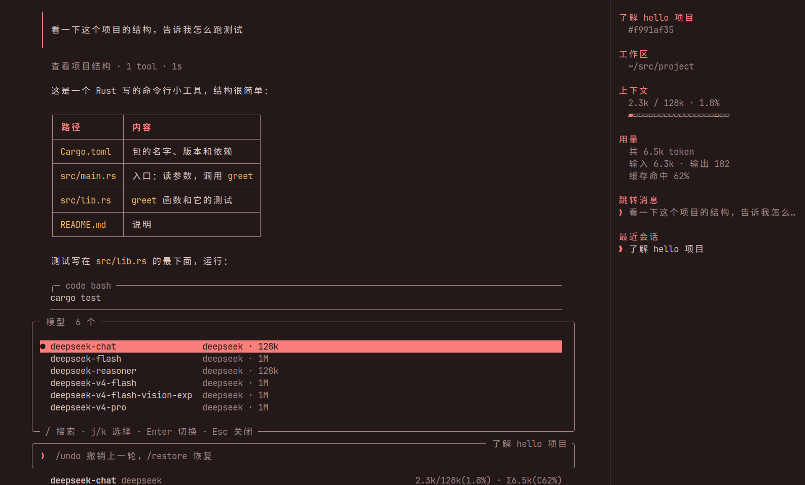

# Commands

> <sub>This document was generated by Anthropic's Claude Fable 5.2.</sub>

This page describes every `/` command of the input box. Typing `/` opens the command list; keep typing to filter it and press `Enter` to run the selected one. You can also type a command in full and press `Enter`.

> Only the commands listed below are commands. Anything else that starts with `/` (for example `/usr/bin has what in it`) is sent to the AI as an ordinary message.

LiteMiyu has 23 commands:

| Command | What it does |
|---|---|
| [`/new`](#new) | Start a new session |
| [`/sessions`](#sessions) (`/resume`) | List sessions and switch to one |
| [`/jump`](#jump) | List what you said in this session and jump to it |
| [`/files`](#files) | See the files this session changed and their diffs |
| [`/rename`](#rename) | Rename the session |
| [`/delete`](#delete) | Delete this session |
| [`/export`](#export) | Export this session to a Markdown file |
| [`/undo`](#undo-and-restore) (`/rewind`) | Undo the last turn |
| [`/restore`](#undo-and-restore) | Bring back the turn you just undid |
| [`/redo`](#redo-and-edit) | Run the last turn again as it was |
| [`/edit`](#redo-and-edit) | Edit your last message and run the turn again |
| [`/stop`](#stop) | Stop everything running in the session |
| [`/clear`](#clear) (`/reset`) | Clear the context |
| [`/compact`](#compact) | Compact the context now |
| [`/loop`](#loop) | Run on a loop |
| [`/model`](#model) | Change the model |
| [`/effort`](#effort) | Change the thinking effort |
| [`/status`](#status) | Show this session's status |
| [`/copy`](#copy) | Copy the last reply |
| [`/icons`](#icons) | Switch icons |
| [`/config`](#config) (`/settings`) | Open the settings screen |
| [`/help`](#help) | See keys and commands |
| [`/exit`](#exit) | Exit |

Names in parentheses are aliases and behave exactly the same.

## Sessions

### /new

Starts a new session. The current one stays on disk and you can return to it with `/sessions`.

- `/new`: the features of the new session follow the `New session features` setting; by default that is all features.
- `/new bare`: starts a session with no features. The AI has no tools and LiteMiyu adds nothing to the conversation, so it is a plain chat with the model.
- `/new full`: starts a session with all features.

Any other argument gets `/new only takes bare (no features) or full (all features)`.

### /sessions

Lists every session on disk, grouped by when it was last used. Select one and press `Enter` to switch to it. Untitled sessions show the beginning of their first message. See [Sessions](sessions.md#the-session-list) for the details.

### /jump

Lists every message you sent in this session, with a preview of the selected one on the right. Press `Enter` on one and the conversation scrolls to it. It is a handy way to find earlier content in a long session.

### /files

Opens the full-screen `Changed files` page with the files the AI changed in this session and the diff of every change; `Esc` goes back. See [Interface](interface.md#changed-files) for the details. When no file has been changed in this session yet, it shows `No files changed in this session yet`.

### /rename

- `/rename a new title`: gives the session this title and shows `Renamed: a new title`.
- `/rename`: asks the AI to write a new title from the conversation.
- `/rename -`: removes the title.

### /delete

Deletes the current session and returns to the new-session screen. The sessions of the subagents it started, fork subagents included, are deleted with it.

> `/delete` does not ask for confirmation. The session is removed from disk right away and cannot be recovered.

A session cannot be deleted while a reply is running; you get `A turn is running: interrupt it before deleting this session`.

### /export

Exports this session to a Markdown file in the directory LiteMiyu was started from, named `litemiyu-session-<short ID>.md`. When done, it shows where the file is and how big, for example:

```text
Exported to /home/user/src/project/litemiyu-session-7695ec32.md (170 B)
```

The file contains your messages and the AI's replies, with one line for each command the AI ran.

## Undo and redo

### /undo and /restore

`/undo` undoes the last turn: your message and the AI's reply are removed from the context, and your message goes back into the input box so you can change it and send it again. Run it repeatedly to go back turn by turn.

`/restore` brings back the turn you just undid. When there is nothing to bring back it says `Nothing to restore`.

`/undo` also undoes `/clear` and compaction, showing `Undid a clear: the context is back to before it`.

> Undo only affects the conversation. Files the AI changed and commands it ran during that turn are not rolled back; use a tool such as `git` to restore files if you need to.

### /redo and /edit

- `/redo`: runs the last turn again as it was, that is, the AI answers the same message again.
- `/edit`: puts your last message back into the input box, whose border shows `Editing your last message · Esc to cancel`. Press `Enter` when you are done to run the turn again with the changed message, or `Esc` to give up.

### /stop

Stops everything running in this session: the current turn, background commands and subagents. Messages still queued are kept and not sent. To interrupt only the current turn, pressing `Esc` twice is enough.

## Context

### /clear

Clears the context: earlier conversation is no longer sent to the model, as if starting over inside the same session. The earlier content stays visible in the conversation, and the session keeps its ID and title. Afterwards you see `● Context cleared`. If that was a mistake, `/undo` brings it back.

### /compact

Compacts the context into a summary now instead of waiting for it to happen automatically. Anything you write after it guides the summary, for example:

```text
/compact keep only what concerns the database migration
```

When the conversation is still short and there is nothing to compact, it says `Not enough context`. For what compaction is, see [Sessions](sessions.md#long-sessions-and-compaction).

## Loops

### /loop

Has the AI do the same thing repeatedly at some pace:

| Form | What it does |
|---|---|
| `/loop <interval> <prompt>` | Sends the prompt at a fixed interval, for example `/loop 5m check whether the build has finished` |
| `/loop <prompt>` | Lets the AI pick when to run next |
| `/loop off` | Stops this session's loops |

See [Subagents, cross-session messages and loops](agents.md#loops-loop). Sessions with no features do not have this command.

## Models

### /model

Opens the model list: every model you have set up, followed by its provider and context window size, with a `●` in front of the one in use. Select one and press `Enter` to switch.



> After switching, this session uses the new model from your next message on, and the new model also becomes the default for future sessions.

### /effort

Opens the thinking effort levels of the current model; pick one and press `Enter`. The first entry, `Follow settings`, uses the default set for this model in settings. If the model has no adjustable effort, you see `This model has no effort levels to choose`.

## Looking things up

### /status

Opens the status panel:

```text
  Session ID         01a1f773-2ee2-728b-b7ca-dc147695ec32
  Working directory  ~/src/project

  Model              deepseek-chat · demo · window 128k
  Context            ▰▱▱▱▱▱▱▱▱▱▱▱▱▱▱▱▱▱▱▱  2k / 128k (1.5%)
  Compaction         0 times · auto at 108.8k
  Usage              2k tokens in all · in 2k · out 5
  Cache hits         0%
  Spent              $0.00
```

Press `c` to copy all of it and `Esc` to close. `Session ID` is the full session ID, which the `-s` option on the command line needs.

### /copy

Copies the AI's last reply to the clipboard and shows `Copied 11 character(s)`. When there is no reply yet it says `No reply to copy yet`.

### /help

Opens the help panel: all commands in the upper half, all keys in the lower half.

## Other

### /icons

Switches between Nerd Font icons and plain characters, one step each time you run it.

### /config

Opens the settings screen, the same one `litemiyu config` opens from the shell. See [Configuration](config.md).

### /exit

Exits LiteMiyu. Pressing `Ctrl+D` with an empty input box does the same.

## Commands in rescue mode

Rescue mode (`litemiyu --rescue`) saves nothing to disk, so the four commands that cannot do without the disk, `/sessions`, `/config`, `/export` and `/delete`, do not exist there; running them shows `No such command`, and `/help` does not list them. `/model` and `/effort` work, but your choice lasts for this run only and does not become the default for later sessions. See [Rescue mode](rescue.md).
