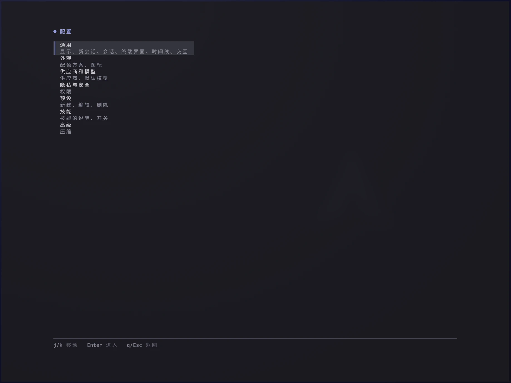
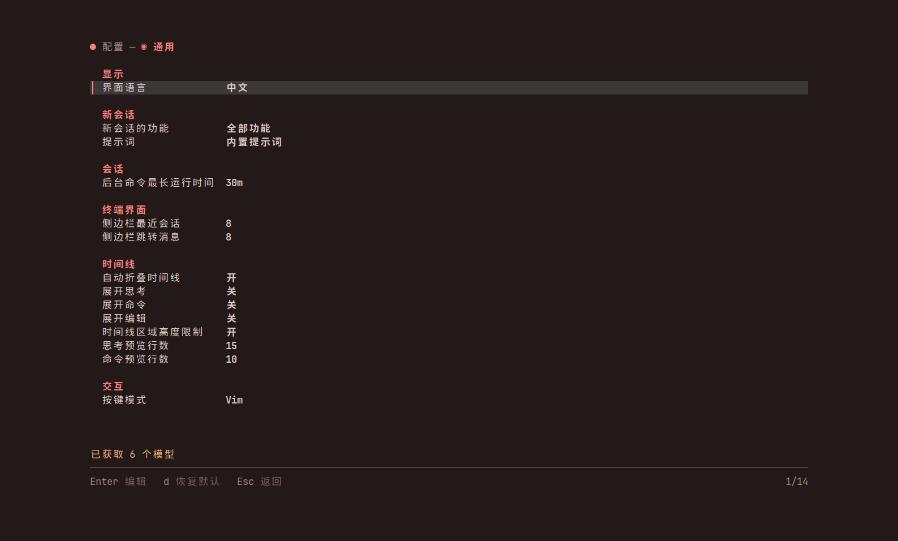

# Configuration

> <sub>This document was generated by Anthropic's Claude Fable 5.2.</sub>

This page covers all of LiteMiyu's configuration: every page of the settings screen and every entry you can write in the configuration file.

## Two ways to change it

LiteMiyu keeps its configuration in one file: `~/.config/litemiyu/config.toml`. There are two ways to change it:

- **The settings screen** (recommended): run `/config` in the interface, or `litemiyu config` in a shell. Changes are written to the configuration file right away.
- **Editing the file**: change `config.toml` with any editor. A few entries can only be changed this way; they are marked below. Restart LiteMiyu afterwards for the changes to apply.

Keys are stored separately, in `secrets.toml` next to it; `config.toml` only holds references to them. So showing `config.toml` to someone or keeping it in your dotfiles repository does not leak your keys.

## The settings screen



The main menu has these pages:

| Page | Content |
|---|---|
| `General` | Display, New sessions, Sessions, Terminal interface, Timeline, Interaction, Permissions, Compaction |
| `Appearance` | Color scheme, Icons |
| `Providers & models` | Providers and default models; see [Models and providers](models.md) |
| `Presets` | Create, edit and delete presets; see [Presets](presets.md). The default preset is set on the `General` page |
| `MCP` | MCP server status and switches. Present only when MCP servers are configured; see [Skills and MCP](skills-mcp.md) |
| `Skills` | Skill descriptions and switches |

The keys are shown at the bottom of every page:

| Key | Action |
|---|---|
| `j` `k` or `↑` `↓` | Move |
| `Enter` | Open a page; change the selected entry |
| `d` | Reset the selected entry to its default, after asking for confirmation |
| `Esc` | Go back one level; `q` leaves the settings screen from the main menu |



After a successful save, the bottom of the page shows `Saved`. Most settings apply immediately or from your next message; only the interface language shows `Takes effect after LiteMiyu restarts`.

## All settings

The settings are listed below in the order of the settings screen. The key is how the setting is written in `config.toml`; for example, `tui.keys` is written as:

```toml
[tui]
keys = "arrows"
```

### General

| Name in the interface | Key | Default | Meaning |
|---|---|---|---|
| `Interface language` | `ui.language` | `auto` | `auto` (follow the system), `zh`, `en`. Applies after a restart |
| `Default preset` | `sessions.default` | `full` | The preset new sessions use unless you choose another: `full` (all features), `bare` (no features) or the name of a preset of your own; see [Presets](presets.md). Only affects sessions started afterwards |
| `Prompt` | (a separate file) | Built-in | Opens `prompt.md` in your editor; see [Prompt, project instructions and memory](memory.md#prompt) |
| `Longest background command` | `jobs.max_running` | `30m` | How long a command the AI put in the background may run, from 1 minute to 2 hours. Written like `30m` or `2h` |
| `Recent sessions in the sidebar` | `tui.sidebar_sessions` | `8` | How many sessions the sidebar lists; `0` hides the list. Range 0 to 100 |
| `Messages to jump to in the sidebar` | `tui.sidebar_jumps` | `8` | How many of your messages the sidebar lists; `0` hides the list. Range 0 to 100 |
| `Auto-fold timeline` | `tui.timeline_fold` | `true` | Fold a turn's steps into one line once the reply is done |
| `Expand thoughts` | `tui.timeline_expand_thought` | `false` | Show thoughts in full instead of a preview |
| `Expand commands` | `tui.timeline_expand_command` | `false` | Show command output in full |
| `Expand edits` | `tui.timeline_expand_edit` | `false` | Show the diffs of file changes in full |
| `Timeline area height limit` | `tui.timeline_limit_live` | `true` | Show only the latest lines of running steps |
| `Thought preview rows` | `tui.timeline_thought_rows` | `15` | How many of the latest lines a running thought shows. Range 3 to 60 |
| `Command preview rows` | `tui.timeline_preview_rows` | `10` | How many lines of command output are previewed at most. Range 3 to 60 |
| `Key mode` | `tui.keys` | `vim` | `vim` or `arrows` (arrow keys); see [Interface and keys](interface.md#key-mode-vim-and-arrow-keys) |
| `Confirmation timeout` | `permission.confirm.timeout` | `300` | How many seconds a dangerous-command confirmation waits for you before it is refused automatically. `0` waits forever. Range 0 to 86400 |
| `Compaction line` | `compaction.line` | `85` | Compact automatically once the context fills this percent of the window, from 20 to 95. Models with small windows keep room for the reply, so compaction actually starts earlier |
| `Pre-compaction` | `compaction.prepare` | `true` | When the context is nearly full, prepare the summary in the background so that the switch at the compaction line happens without a wait |

### Appearance

| Name in the interface | Key | Default | Meaning |
|---|---|---|---|
| `Color mode` | `tui.theme_mode` | `auto` | `auto` (follow the terminal's background), `dark`, `light` |
| `Background fill` | `tui.theme_background` | `true` | Paint the whole screen in the color scheme's background. When off, the terminal's own background is used, which suits terminals with a transparent background |
| `Icons` | `tui.icons` | `nerd` | `nerd` (Nerd Font icons) or `plain` (plain characters) |

LiteMiyu has no themes to switch between. Its colors are calculated from the terminal's foreground and background colors, so when you change the terminal's color scheme, LiteMiyu's colors change with it.

### Providers & models

How to use this page is described in [Models and providers](models.md). The corresponding configuration:

```toml
[providers.deepseek]
key = { secret = "deepseek" }

[providers.local]
name = "My local models"
driver = "openai-chat"
base_url = "http://127.0.0.1:8080/v1"

[providers.local.models.my-model]
window = 32000
max_output = 4096

[models]
chat = "deepseek/deepseek-chat"
```

Each provider has a `[providers.<ID>]` table:

| Key | Meaning |
|---|---|
| `name` | The name shown in the interface. When missing, the name from the model catalog is used, and the ID if the catalog has none |
| `driver` | The API: `openai-chat`, `anthropic`, `openai-responses`. Providers in the model catalog can leave it out |
| `base_url` | The API address. Providers in the model catalog can leave it out |
| `key` | A reference to the key: `{ secret = "name" }` points to a line in `secrets.toml`, and `{ env = "VARIABLE" }` reads an environment variable. When missing, requests carry no authentication |
| `catalog` | Which provider in the model catalog this one corresponds to. For example, a relay that only forwards DeepSeek can set `catalog = "deepseek"`, so that windows and prices are taken from DeepSeek's entries |
| `local` | Whether this is a model service on your own machine (priced at 0). When missing, the address decides: an address on this machine means yes |

Each model can have a `[providers.<ID>.models.<model>]` table. All keys are optional and add to or override the model catalog's data:

| Key | Meaning |
|---|---|
| `window` | The context window, in tokens |
| `max_output` | The maximum output, in tokens |
| `inputs` | The inputs it accepts, for example `["text", "image"]`. Possible values: `text`, `image`, `pdf`, `audio`, `video` |
| `effort` | The default thinking effort; must be one of the model's levels |
| `temperature` | The temperature, 0 to 2. Not sent when missing |
| `reasoning` | The thinking effort levels this model has, for example `["low", "medium", "high"]`. File only |
| `catalog` | Which catalog model this one corresponds to, written as `provider/model`. File only |

The default models are in the `[models]` table:

| Key | Meaning |
|---|---|
| `chat` | The model new sessions use, written as `provider/model` |
| `vision` | The multimodal model: it provides multimodal input when the chat model lacks it. May be left out |

#### Model prices

When the model catalog has no price, or your price differs from the catalog's (for example a relay with a discount), write the price in the file and the cost in the footer is calculated from it. Prices can only be written in the file:

```toml
[providers.local.models.my-model.price]
input = 2.0          # price per million input tokens
output = 8.0         # price per million output tokens
cache_read = 0.2     # optional: input that hit the cache
cache_write = 2.5    # optional: input written to the cache
currency = "CNY"     # optional: currency, USD by default
```

As soon as one of these is written, the model's whole price is taken from what you wrote. For a plain discount you can skip the prices and write a multiplier in the model's table instead, for example `price_multiplier = 0.5`.

#### Model catalog

How the model catalog is downloaded can only be changed in the file, and usually needs no change:

```toml
[models.catalog]
update = true                          # false means never download
url = "https://models.dev/api.json"    # where to download from
every = "24h"                          # how often to refresh, from 1 hour to 30 days
```

The environment variable `LITEMIYU_CATALOG_UPDATE=false` does the same as `update = false` and takes precedence over the configuration file.

### MCP and skills

MCP servers are written in `[mcp.<name>]` tables; see [Skills and MCP](skills-mcp.md#adding-an-mcp-server).

The switches for skills and MCP servers are in the `[features]` table. Anything not written there is on:

```toml
[features]
skill-commit-message = false    # switch off the skill named commit-message
mcp-echo = false                # switch off the MCP server named echo
```

## What happens when the configuration is wrong

- **A single setting is wrong** (the name does not exist, or the value is not valid): that setting is ignored and its default is used; everything else applies as usual. When you send your first message you see `These entries are invalid and were ignored: setting …`; see [Skills and MCP](skills-mcp.md#these-entries-are-invalid-and-were-ignored).
- **The whole file has a syntax error** (it is not valid TOML): LiteMiyu still starts, but you cannot chat, and the settings screen cannot change anything; it shows `config.toml has a syntax error at line 16, column 2: fix it by hand, then reopen`. Fix the line it names with an editor.

> If you really cannot fix it, rename `config.toml`, run `litemiyu` again to go through the first-run setup, and then copy what you need back from the old file.

## A complete example

```toml
[ui]
language = "en"

[tui]
keys = "arrows"
icons = "plain"
theme_mode = "dark"

[sessions]
default = "full"

[providers.deepseek]
key = { secret = "deepseek" }

[models]
chat = "deepseek/deepseek-chat"

[compaction]
line = 80

[permission.confirm]
timeout = 600

[jobs]
max_running = "1h"
```

And the matching `secrets.toml`:

```toml
deepseek = "sk-…"
```
