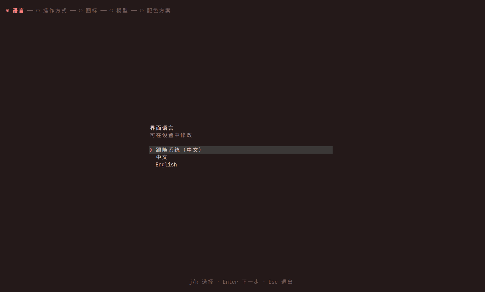
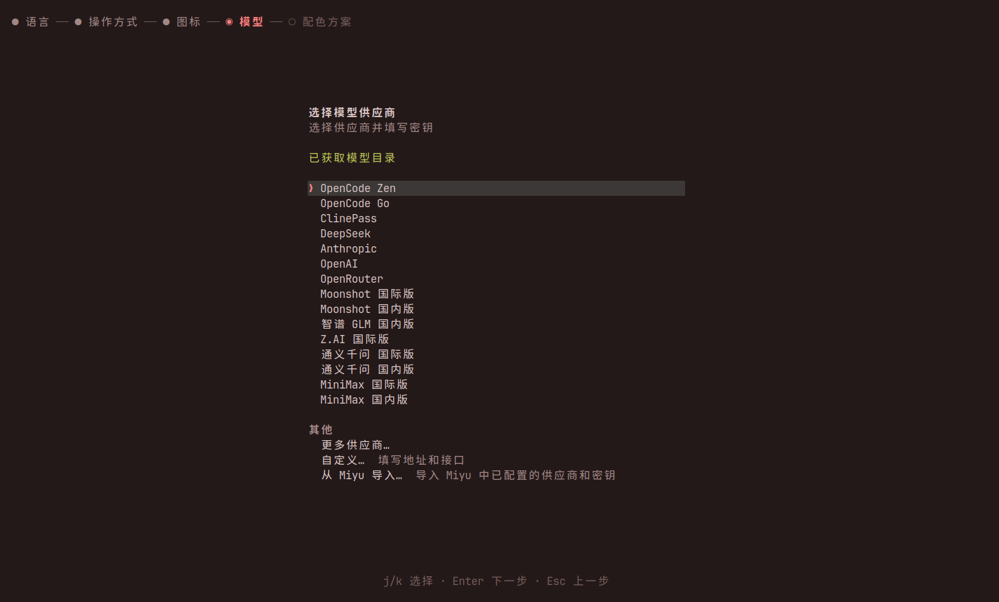
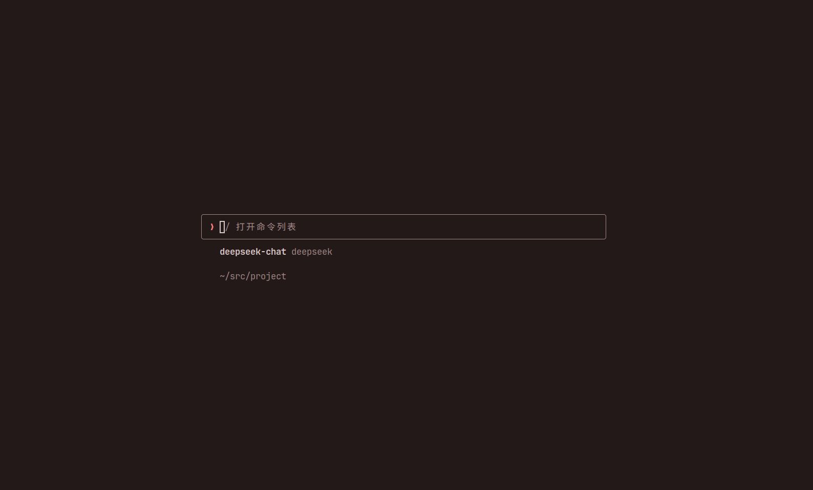

# Quick start

> <sub>This document was generated by Anthropic's Claude Fable 5.2.</sub>

This page gets LiteMiyu installed, walks you through the first-run setup, sends your first message, and then covers the things you will use most. Follow it from top to bottom.


## Install

LiteMiyu is a single program file, `litemiyu`. Once it is on your `PATH`, it is installed. It runs on Linux, macOS and BSD; on Windows, use the Linux build inside WSL2.

- Arch Linux: install from the AUR with `paru -S litemiyu-bin`. This is the recommended way.
- Other Linux distributions and macOS (Apple silicon): download the archive for your system from the [releases page](https://github.com/miyu-agent/litemiyu/releases), unpack it, and put the `litemiyu` inside into `~/.local/bin`.
- Intel Macs and BSD: there is no release package, so build from source.

The full steps for each method, checksum verification, upgrading and uninstalling are in [Install, upgrade, uninstall](install.md).

After installing, run:

```bash
litemiyu --version
```

If it prints `litemiyu <version>`, the installation worked.

## First start

The AI works in the directory LiteMiyu was started from. So change into your project directory first, then run `litemiyu`:

```bash
cd ~/src/project
litemiyu
```

On the first start there is no configuration yet, so LiteMiyu opens the first-run setup. The top line of the screen shows the progress: `Language`, `Controls`, `Icons`, `Model`, `Color scheme`. In every step, choose with `j` and `k` or the arrow keys, press `Enter` to go on, and `Esc` to go back.



### Language

Choose whether the interface is shown in Chinese or English. The first option, `Follow the system`, decides from your system locale; the default is usually fine.

### How do you like to move around?

This step decides how you move and search in lists:

- `Vim`: `j` and `k` move, `/` starts a search. This is the default.
- `Arrow keys`: `↑` and `↓` move, and typing searches right away.

If you have never used Vim, `Arrow keys` will feel more natural. The choice only affects lists; typing in the input box is not affected.

### Icons

The screen shows a row of sample icons and asks `Do you see icons, or boxes and garbled text?`. If the icons look right, choose `Icons`. If you see boxes or garbage, your terminal font is not a Nerd Font; choose `Boxes or garbage` and the interface will use plain characters instead.

### Choose a model provider

This step connects LiteMiyu to an AI provider. LiteMiyu first downloads a model catalog (from models.dev) and then lists the common providers:



1. Choose a provider

    Select the provider you have a key for and press `Enter`. If it is not in the list, `More providers…` lets you search all of them; for a self-hosted or company-internal service, choose `Custom…` and enter the address and API yourself.

    > If Miyu is installed on this machine, the list also ends with `Import from Miyu…`, which brings over the providers and keys you already set up in Miyu.

2. Enter the key

    Press `Enter` on the `Key` row, paste the API key your provider gave you, and press `Enter` again. The key is stored only on your own machine, in `~/.config/litemiyu/secrets.toml`, a file only you can read.

3. Test the connection

    Select `Test connection →` and press `Enter`. On success you see a message such as `✓ Connected, found 2 models` followed by the provider's models. On failure you see the reason, for example `Didn't work (listing models): wrong key or no permission (HTTP 401)`; fix it and test again.

4. Choose a model

    Pick a model from the list as your default and press `Enter`. When there are many, press `/` to search.

Without a network connection the catalog cannot be downloaded, and the list only contains `More providers…` and `Custom…`. In that case choose `Custom…` and fill in the details by hand. See [Models and providers](models.md) for more.

### Color scheme

LiteMiyu takes its colors from your terminal. In this step you can set the `Color mode` (`Auto`, `Dark`, `Light`) and whether to use `Background fill`. Changes show immediately; when you are happy, select `Next →` and press `Enter`.

The last screen says `All set` and shows the model you chose. Press `Enter` to start chatting.

> Everything above can be changed later in settings: run `/config` in the input box.

## Send your first message

After the setup you see an input box with the current model and working directory below it:



Type and press `Enter` to send. For example:

```text
Look at how this project is laid out and tell me how to run the tests
```

The AI reads files and runs commands on its own. The steps appear above the reply and fold into one line when it finishes; tables and code in the reply are laid out properly. The line below the input box is the footer: the model on the left, and on the right how much context and how many tokens this session has used.

The AI does not ask before reading or writing files or running ordinary commands. Only dangerous commands such as `git push --force` bring up a confirmation, and you decide whether to allow them. See [Tools and permissions](tools.md) for details.

## The things you will use most

- New line: `Shift+Enter` or `Ctrl+J`.
- Interrupt the AI: press `Esc` twice while it is replying.
- Commands: typing `/` in the input box opens the command list. For example, `/new` starts a new session, `/model` changes the model, and `/help` shows every key and command. All commands are listed in [Commands](commands.md).
- Run a command yourself: start with `!`, for example `!git status`. The command runs directly, and the AI sees its output too.
- Undo: if a reply went the wrong way, `/undo` removes the last turn and puts your message back in the input box so you can change it and send it again.
- Return to an earlier session: `/sessions` lists them all; or start with `litemiyu -c` to open the latest one.
- Exit: press `Ctrl+D` with an empty input box, or run `/exit`.

## Where to go next

- To learn the parts of the interface and every key, see [Interface and keys](interface.md).
- To add more providers or change the default model, see [Models and providers](models.md).
- To call LiteMiyu from scripts, see [Command line](cli.md).
- The full table of contents is [here](../README.md).
