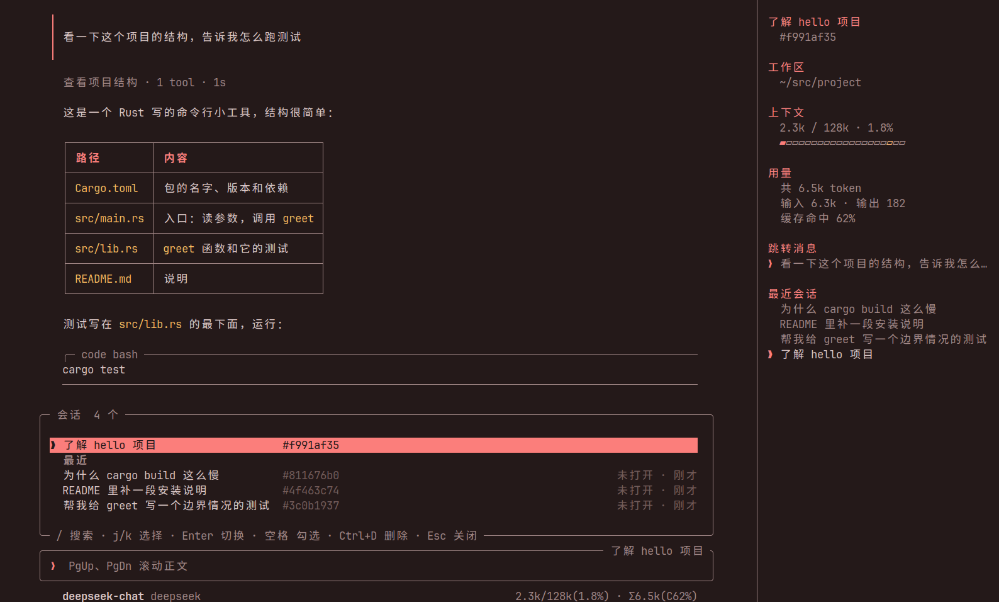

# Sessions

> <sub>This document was generated by Anthropic's Claude Fable 5.2.</sub>

A session is one continuous conversation between you and the AI. Every session is saved to disk, so you can close the window and come back to it at any time. This page covers starting, continuing and tidying up sessions, and what LiteMiyu does when a session grows long.

## Starting a session

- Running `litemiyu` gives you a new session. It is not saved to disk until you send the first message.
- Inside the interface, `/new` starts a new session and keeps the old one on disk.

A session's working directory is the directory LiteMiyu was started from, and it does not change once the session exists. To have the AI work in another project, start LiteMiyu again from that directory.

### Two kinds of session

| | All features | No features |
|---|---|---|
| How to start | `/new`, `litemiyu` | `/new bare`, `litemiyu --bare` |
| Tools | All | None |
| Content added to the conversation automatically | Time, working directory, project instructions, skill list, memory and so on | Nothing |
| Good for | Getting work done | Just chatting with the model or asking questions |

Which kind a session is gets fixed when it is created and cannot change midway; use `/new` to switch. If you want new sessions to have no features by default, change `New session features` on the `General` page of `/config`.

## Continuing an earlier session

At startup:

```bash
litemiyu -c             # open the latest session
litemiyu -s <id>        # open the given session
```

`-s` needs the full session ID, for example `01a1f757-91fc-74f7-b69f-b1c414c7090c`. You can see the full ID in `/status`, or copy it by clicking the short ID in the sidebar.

Inside the interface: run `/sessions`, or click an entry under `Recent sessions` in the sidebar.

> A session can be open in only one window at a time. If it is already open elsewhere, you get `session … is open in another window`. Different sessions can be open in different windows at the same time.

## The session list

Run `/sessions` (or `/resume`) to open the session list:



The first row is the current session; below it the rest are grouped under `Recent`, `Past 7 days`, `Past 30 days` and `Older`. Each row shows the session's title, short ID, state and when it was last used. Untitled sessions show their first message; sessions created by `litemiyu ask` are listed here as well.

There are three states: `Not open`, `Open in another window` and `Busy in another window`.

| Key (`Vim` mode) | Action |
|---|---|
| `j` `k` | Move up and down |
| `/` | Search; `Enter` finishes and `Esc` cancels |
| `Enter` | Switch to the selected session |
| Space | Tick; several can be ticked |
| `Ctrl+D` | Delete the selected or ticked sessions; press again to confirm |
| `Esc` | Close the list |

In `Arrow keys` mode, move with `↑` and `↓` and just type to search.

## Naming a session

LiteMiyu does not title sessions automatically. Run `/rename a title` to set one yourself, or just `/rename` to have the AI write one. The title appears at the top right of the input box, in the sidebar and in the session list.

## Finding earlier content in a session

- `/jump`: lists every message you sent in this session; pick one to jump to it. `Jump to` in the sidebar is a shortcut for it.
- `Ctrl+R`: lists what you have typed before (across all sessions); pick an entry to put it back into the input box.

## Undo and restore

| Command | What it does |
|---|---|
| `/undo` | Undoes the last turn and puts your message back into the input box. Can be repeated |
| `/restore` | Brings back the turn you just undid |
| `/redo` | Has the AI do the last turn again with the same message |
| `/edit` | Lets you change your last message and runs the turn again |

After an undo, the conversation keeps a line saying `↶ Undone · /restore to bring it back`.

> Undo applies to the conversation only. Files the AI already changed and commands it already ran are not rolled back.

## Export

Run `/export` and the session is written to a Markdown file in the directory LiteMiyu was started from, named `litemiyu-session-<short ID>.md`. The file looks like this:

```markdown
# My first session

## You

hello

## Reply

OK, got it.
```

## Delete

- To delete the current session, run `/delete`. It does not ask for confirmation.
- To delete other sessions, select one or tick several with Space in the session list and press `Ctrl+D`. The bottom edge then says `Press Ctrl+D again to delete 2 sessions`; only the second press deletes.

Deleted sessions cannot be recovered. Deleting a session also deletes the sessions of the subagents it started.

## Long sessions and compaction

A model can only handle so much content at once; that limit is its context window. As a conversation grows, it eventually stops fitting. LiteMiyu's answer is compaction: the model writes a summary of the earlier conversation, the summary replaces the original text, and the most recent content stays as it is.

- **Automatic compaction**: happens when the context reaches about 85% of the window. Afterwards the conversation shows a line such as `● Context compacted: 17.3k → 1.7k tokens`. `/status` shows how many times the session was compacted and when the next one is due, for example `1 times · auto at 9.4k`.
- **Manual compaction**: run `/compact`, optionally followed by guidance for the summary.
- **Pre-compaction**: when the context is nearly full, LiteMiyu prepares the summary in the background so that the switch happens without a wait.

After compaction:

- The earlier content is still in the conversation; scroll up to see it, and `/jump` keeps working. Compaction only changes what is sent to the model.
- When the AI needs details from before the compaction, it can look them up in the session log with the `history` tool.
- If a compaction went wrong, `/undo` reverts it and shows `Undid a compaction: the context is back to before it`.

The compaction line and pre-compaction can be adjusted on the `Advanced` page of `/config`; see [Configuration](config.md). If LiteMiyu does not know the model's window size, it does not compact automatically; see [Models and providers](models.md#when-the-context-window-is-unknown).

> When one job is finished and the next has nothing to do with it, running `/clear` to clear the context or `/new` to start a new session costs fewer tokens than carrying on in the same session, and the AI is less likely to be distracted by old content.

## When a session will not open

- `The session can't be read right now; retrying in 5 seconds`: reading the session files failed. LiteMiyu retries a few times on its own, and if all attempts fail it says `The session can't be read right now. Please try again later`.
- `The session log is broken at line …; only the part before it can be viewed and the session can't continue. Start a new session to go on.`: the session file is damaged in the middle. The session opens read-only so you can view what came before the damage; to keep working, run `/new`.
