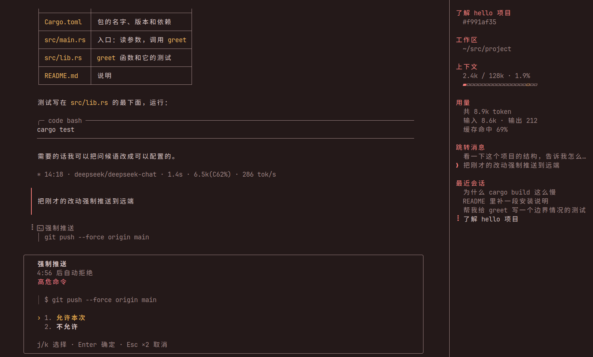

# Tools and permissions

> <sub>This document was generated by Anthropic's Claude Fable 5.2.</sub>

The AI reads and writes files and runs commands through the tools LiteMiyu gives it. This page lists those tools, says which actions ask you first, and which are never carried out.

## Tools the AI can use

LiteMiyu comes with 12 tools, all built into the program; nothing needs installing:

| Tool | What it does |
|---|---|
| `read` | Reads a text file or an image, or lists a directory |
| `write` | Creates a file, or replaces all of a file's content |
| `edit` | Replaces exact text in a file, several places per call |
| `shell` | Runs a command and returns its output; can run it in the background |
| `jobs` | Lists background commands and subagents, reads a background command's output, stops one |
| `subagent` | Starts a sub-session that does one task in the background |
| `send_message` | Sends a message to a subagent, to its parent, or to another session |
| `sessions` | Lists your other sessions |
| `session_usage` | Shows how many tokens this session has used and how full the context is |
| `history` | Searches and reads back earlier parts of this session, including what compaction removed |
| `ask_user` | Asks you questions with options and waits for your answers |
| `schedule_wakeup` | In a self-paced `/loop`, decides when the next run happens |

In addition, tools offered by the MCP servers you connect are handed to the AI as well; see [Skills and MCP](skills-mcp.md).

LiteMiyu has no dedicated file search, web fetch or trash tool. To search, the AI runs `grep` or `find` through `shell`; to reach the web, it runs `curl`; to delete files, it uses `rm`.

> Deleted files do not go to a trash can. Keep important projects in `git` so that mistakes by the AI can be undone.

Different sessions have different tools:

| Session | Tools |
|---|---|
| All features (default) | All 12, plus MCP tools |
| No features (`/new bare`, `litemiyu --bare`) | None |
| Rescue mode (`litemiyu --rescue`) | Only `read`, `write`, `edit`, `shell`, `jobs` |
| Subagent | No `ask_user` or `sessions` |

## Permissions: no questions by default

LiteMiyu has no sandbox and no permission levels. The AI does not ask you step by step when it reads or writes files or runs commands; commands run directly as your user and can do anything you could do in a terminal.

That makes it smooth to use, but models do make mistakes now and then, so LiteMiyu keeps three guards, described below.

> If you need stricter isolation, run LiteMiyu inside a container or virtual machine, or as a separate system user.

## Actions that ask first: dangerous commands

Before the AI runs a command of the following kinds, LiteMiyu shows a confirmation:

| Kind | Examples |
|---|---|
| Rewriting remote git history | `git push --force` |
| Discarding local changes | `git reset --hard`, `git clean -f`, `git checkout -- .`, `git restore .`, `git stash drop` |
| Deleting the working directory itself or one above it | `rm -rf .` |
| Recursive deletes whose target is only known at run time | `rm -rf "$DIR"` |
| Powering off or rebooting | `shutdown`, `reboot` |
| Downloading and running in one go | `curl … \| sh` |
| Giving a container host devices or namespaces | `docker run --device …`, `--pid host` |

LiteMiyu judges by the text of the command and sees through wrappers such as `sudo`, `env` and `sh -c`.



The confirmation shows the title the AI gave this step, the `Dangerous command` mark and the full command. Choose with `j` and `k` and confirm with `Enter`:

- `Allow once`: runs this one command. It applies to this time only; the next one asks again.
- `Don't allow`: does not run it. With this entry selected you can press `n` to write a reason; the AI sees it and can try another approach.

Pressing `Esc` twice also refuses.

The top of the confirmation shows a countdown such as `Auto-deny in 4:58`. The default wait is 300 seconds; with no answer by then, the command is refused, so the AI does not hang forever while you are away. Change the wait under `Confirmation timeout` on the `Privacy & security` page of `/config`; `0` waits forever.

## Actions that are always blocked

The following cannot be undone once they run, so LiteMiyu refuses them outright. It does not ask, and there is no way to allow them from the interface:

- Deleting the root directory, for example `rm -rf /`.
- Deleting your home directory or a directory above it.
- Deleting system directories under the root, such as `/usr`, `/etc` and `/home`.
- Deleting LiteMiyu's own data directories.
- Formatting disks: `mkfs`, `wipefs`.
- Writing straight to disk devices: `dd of=/dev/…`.
- Handing the whole host to a container: `docker run --privileged`, mounting `/` into a container, and the like.

After a block, the AI receives a note (for example, that the command would delete the root directory and so was not run) and carries on with something else. If you really need such a command, run it yourself in a terminal.

## LiteMiyu's own data

The AI's tools can neither read nor change LiteMiyu's own data directories, which hold the configuration file, the key file and the session logs. This keeps the AI from reading your API keys or breaking the configuration.

Two folders are exceptions that the AI may read and write:

- The memory folder; see [Prompt, project instructions and memory](memory.md).
- The folder you keep skills in; see [Skills and MCP](skills-mcp.md).

## Questions from the AI

When unsure, the AI can ask you with `ask_user`. The question and its options appear where the input box is:

```text
Which database should it use?

› 1. SQLite (Recommended)
     One file, no server to install
  2. PostgreSQL
     Needs a separate server
  3. Type another answer

j/k select · Enter submit · n notes · Esc ×2 cancel
```

Choose with `j` and `k` and submit with `Enter`. If no option fits, choose `Type another answer` and write your own; press `n` to add a note alongside your choice. For multiple-choice questions, tick with Space; when several questions come at once, switch between them with `←` and `→`.

Questions have no time limit; LiteMiyu waits until you answer.

## On the command line

Nobody can answer a confirmation while `litemiyu ask` runs, so dangerous commands that need confirmation are refused and the exit status at the end is 4. Add `--yes` if you really want to allow them. The always-blocked actions are refused even with `--yes`. See [Command line](cli.md#dangerous-commands-and---yes).
