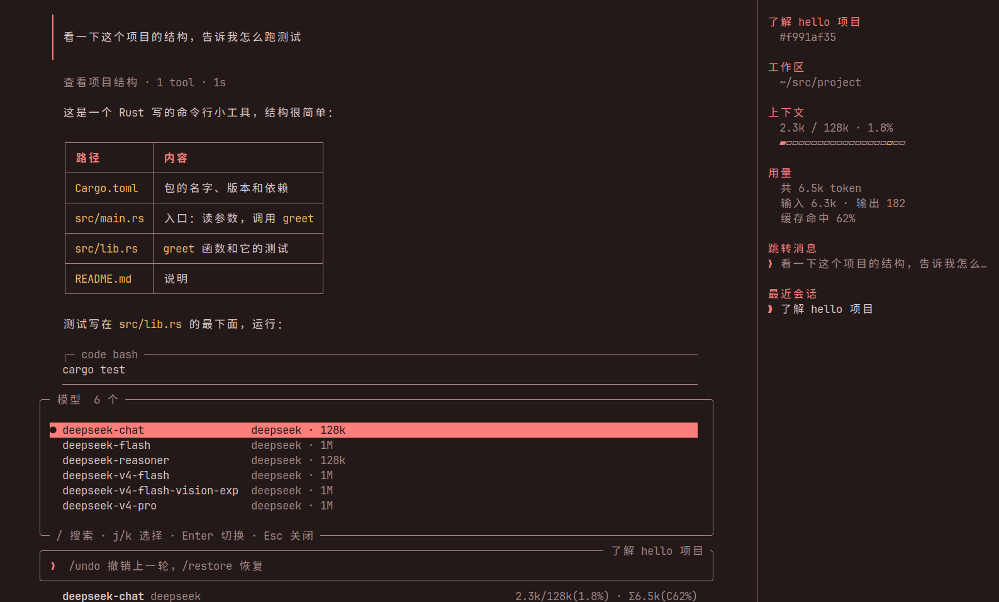

# 命令

> <sub>本文档由 Anthropic 的 Claude Fable 5.2 生成。</sub>

这一页是输入框里全部 `/` 命令的说明。在输入框里输入 `/` 会打开命令列表，继续打字可以筛选，`Enter` 执行选中的那一条；也可以把命令完整打出来再按 `Enter`。

> 只有下面列出的才是命令。其他以 `/` 开头的话（例如 `/usr/bin 里有什么`）会照常发给 AI。

LiteMiyu 一共有 23 条命令：

| 命令 | 作用 |
|---|---|
| [`/new`](#new) | 开一个新会话 |
| [`/sessions`](#sessions)（`/resume`） | 列出会话，切换过去 |
| [`/jump`](#jump) | 列出这个会话里你说过的话，跳过去 |
| [`/files`](#files) | 查看这个会话修改过的文件和差异 |
| [`/rename`](#rename) | 给会话改名 |
| [`/delete`](#delete) | 删除当前会话 |
| [`/export`](#export) | 把这个会话导出成 Markdown 文件 |
| [`/undo`](#undo-和-restore)（`/rewind`） | 撤销上一轮 |
| [`/restore`](#undo-和-restore) | 恢复刚才撤销的那一轮 |
| [`/redo`](#redo-和-edit) | 把最后一轮原样重来一遍 |
| [`/edit`](#redo-和-edit) | 修改你说的上一句话，再重来 |
| [`/stop`](#stop) | 停止这个会话里所有正在进行的东西 |
| [`/clear`](#clear)（`/reset`） | 清空上下文 |
| [`/compact`](#compact) | 现在就压缩上下文 |
| [`/loop`](#loop) | 循环执行 |
| [`/model`](#model) | 换模型 |
| [`/effort`](#effort) | 换思考程度 |
| [`/status`](#status) | 查看这个会话的状态 |
| [`/copy`](#copy) | 复制上一轮的回答 |
| [`/icons`](#icons) | 切换图标 |
| [`/config`](#config)（`/settings`） | 打开配置界面 |
| [`/help`](#help) | 查看按键和命令 |
| [`/exit`](#exit) | 退出 |

括号里的是别名，作用完全一样。

## 会话

### /new

开一个新会话，当前的会话保存在磁盘上，以后可以用 `/sessions` 回来。

- `/new`：新会话的功能按照设置里的 `新会话的功能` 决定，默认是全部功能。
- `/new bare`：开一个“无功能”的会话。AI 没有任何工具，LiteMiyu 也不向对话里加入任何内容，相当于直接和模型聊天。
- `/new full`：开一个全部功能的会话。

写了其他参数会提示 `/new 的参数只能是 bare（无功能）或 full（全部功能）`。

### /sessions

列出磁盘上的全部会话，按最近使用的时间分组。选中一个按 `Enter` 切换过去。没有起名的会话显示第一句话的开头。详细的操作见[会话](sessions.md#会话列表)。

### /jump

列出这个会话里你说过的每一句话，右边是选中那一句的预览。选中一句按 `Enter`，正文会滚动到那一句的位置。会话很长的时候用它找以前的内容很方便。

### /files

打开整屏的 `文件修改` 页，查看这个会话里 AI 修改过的文件和每一次修改的差异，`Esc` 返回。详细的操作见[界面](interface.md#文件修改)。这个会话还没有修改过文件时提示 `这个会话还没改过文件`。

### /rename

- `/rename 新的名字`：把会话改成这个名字，提示 `已改名：新的名字`。
- `/rename`：让 AI 根据对话内容重新起一个名字。
- `/rename -`：去掉名字。

### /delete

删除当前的会话，然后回到新会话的界面。这个会话派出的子代理（包括 fork 子代理）的会话会一起删除。

> `/delete` 不会询问确认，会话直接从磁盘上删除，无法恢复。

回答进行中不能删除，会提示 `回答进行中：先打断再删除当前会话`。

### /export

把这个会话导出成一个 Markdown 文件，放在启动 LiteMiyu 时所在的目录里，文件名是 `litemiyu-session-<短编号>.md`。完成后提示文件的位置和大小，例如：

```text
已导出到 /home/user/src/project/litemiyu-session-14c7090c.md（851 B）
```

导出的文件里是你说的话和 AI 的回答，AI 运行过的命令各占一行。

## 撤销和重来

### /undo 和 /restore

`/undo` 撤销上一轮：这一轮你说的话和 AI 的回答从上下文里拿掉，你说的那句话回到输入框里，可以修改之后重新发送。连续运行可以一轮一轮往前撤销。

`/restore` 把刚才撤销的那一轮恢复回来。没有可以恢复的内容时提示 `没有可恢复的撤销`。

`/undo` 也可以撤销 `/clear` 和压缩，提示 `已撤销清空，上下文恢复到清空前`。

> 撤销的只是对话。AI 在这一轮里修改过的文件、运行过的命令不会被还原，需要的话请使用 `git` 之类的工具恢复文件。

### /redo 和 /edit

- `/redo`：把最后一轮原样重来一遍，也就是用同一句话让 AI 重新回答。
- `/edit`：把你说的上一句话放回输入框，输入框的边框上显示 `编辑上一条 · Esc 取消`。改完按 `Enter`，就用改过的话重来这一轮；按 `Esc` 放弃修改。

### /stop

停止这个会话里所有正在进行的东西：当前这一轮、后台命令和子代理。排着队还没有发出去的话会留着，不会发出。只想打断当前这一轮的话，连按两次 `Esc` 就可以了。

## 上下文

### /clear

清空上下文：之前的对话不再发给模型，相当于在同一个会话里重新开始。正文里以前的内容还看得到，会话的编号和名字不变。清空之后显示 `● 上下文已清空`。清错了可以运行 `/undo` 恢复。

### /compact

现在就把上下文压缩成一段摘要，不等它自动压缩。后面可以写对摘要的要求，例如：

```text
/compact 只保留和数据库迁移有关的内容
```

对话还很短、没有可以压缩的内容时，会提示 `没有可压缩的内容`。压缩是怎么回事见[会话](sessions.md#长会话和压缩)。

## 循环

### /loop

让 AI 按照一定的节奏反复执行同一件事：

| 写法 | 作用 |
|---|---|
| `/loop <间隔> <要说的话>` | 每隔一段时间说一次，例如 `/loop 5m 看一下构建跑完没有` |
| `/loop <要说的话>` | 由 AI 自己决定下一次什么时候执行 |
| `/loop off` | 停止这个会话的循环 |

详细的见[子代理、跨会话消息和循环](agents.md#循环loop)。“无功能”的会话里没有这条命令。

## 模型

### /model

打开模型列表，列出已经配置的全部模型，后面是供应商和上下文窗口的大小，当前使用的那个前面有一个 `●`。选中一个按 `Enter` 切换。



> 切换之后，这个会话从下一句话开始使用新模型，同时新模型也会成为以后新会话的默认模型。

### /effort

打开当前模型的思考程度列表，选一档按 `Enter`。第一项 `跟随设置` 表示使用设置里给这个模型定的默认值。如果模型没有可以调的思考程度，会显示 `该模型没有可选的思考程度`。

## 查看

### /status

打开状态面板：

```text
  会话 ID       01a1f757-91fc-74f7-b69f-b1c414c7090c
  当前工作目录  ~/src/project

  模型          deepseek-chat · demo · 窗口 128k
  上下文        ▰▱▱▱▱▱▱▱▱▱▱▱▱▱▱▱▱▱▱▱  2k / 128k（1.6%）
  压缩          0 次 · 到 108.8k 自动压缩
  用量          共 4k token · 输入 3.9k · 输出 8
  缓存命中      45%
  花费          $0.00
```

按 `c` 可以把这些内容复制下来，`Esc` 关闭。`会话 ID` 是完整的会话编号，命令行的 `-s` 选项要用它。

### /copy

把上一轮 AI 的回答复制到剪贴板，提示 `已复制 4 个字符`。还没有回答时提示 `没有可复制的回答`。

### /help

打开帮助面板，上半部分是全部命令，下半部分是全部按键。

## 其他

### /icons

在 Nerd Font 图标和普通字符之间切换，每运行一次换一种。

### /config

打开配置界面，和在终端里运行 `litemiyu config` 是同一个界面。见[配置](config.md)。

### /exit

退出 LiteMiyu。也可以在输入框为空时按 `Ctrl+D`。

## 应急模式下的命令

应急模式（`litemiyu --rescue`）不向磁盘保存任何内容，所以没有 `/sessions`、`/config`、`/export`、`/delete` 这四条离不开磁盘的命令，运行它们会提示 `命令不存在`，`/help` 里也不列出。`/model` 和 `/effort` 可以使用，但是选择只在这一次运行里有效，不会成为以后新会话的默认。见[应急模式](rescue.md)。
