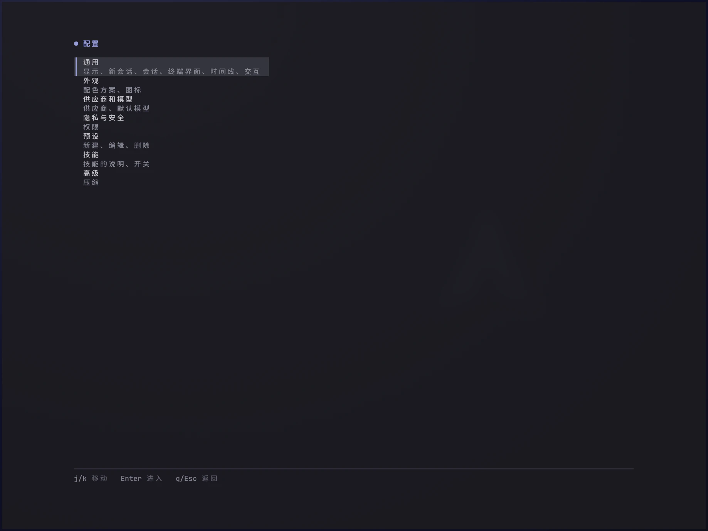
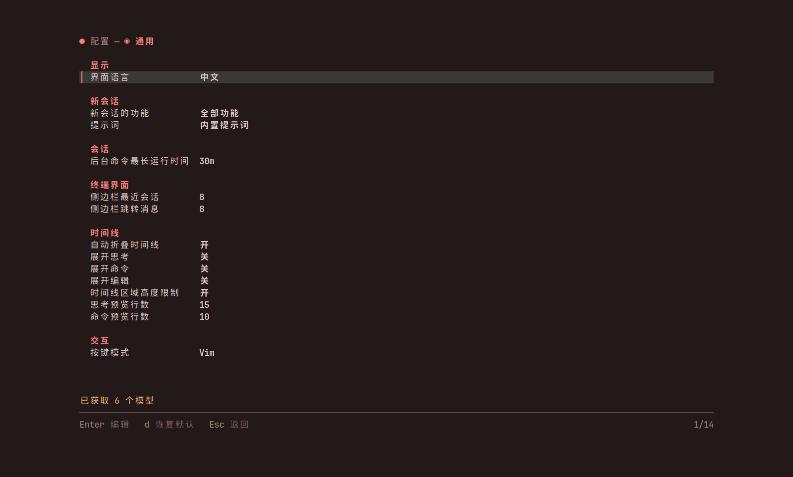

# 配置

> <sub>本文档由 Anthropic 的 Claude Fable 5.2 生成。</sub>

这一页是 LiteMiyu 的全部配置：配置界面的每一页，以及配置文件里可以写的每一项。

## 两种改法

LiteMiyu 的配置保存在一个文件里：`~/.config/litemiyu/config.toml`。修改它有两种方法：

- **配置界面**（推荐）：在界面里运行 `/config`，或者在终端里运行 `litemiyu config`。改动会立即写进配置文件。
- **直接编辑文件**：用任何编辑器修改 `config.toml`。有几项只能用这种方法修改，下面会标出来。修改之后重新启动 LiteMiyu 生效。

密钥单独保存在旁边的 `secrets.toml` 里，`config.toml` 里只写引用，所以把 `config.toml` 给别人看、放进自己的 dotfiles 仓库都不会泄露密钥。

## 配置界面



主菜单有这几页：

| 页 | 内容 |
|---|---|
| `通用` | 显示、新会话、会话、终端界面、时间线、交互 |
| `外观` | 配色方案、图标 |
| `供应商和模型` | 供应商、默认模型，见[模型和供应商](models.md) |
| `隐私与安全` | 权限 |
| `预设` | 新建、编辑、删除预设，见[预设](presets.md)。默认预设在 `通用` 页设置 |
| `MCP` | MCP 服务的状态、开关。配置了 MCP 服务才有这一页，见[技能和 MCP](skills-mcp.md) |
| `技能` | 技能的说明、开关 |
| `高级` | 压缩 |

操作方法写在每一页的最下面：

| 按键 | 作用 |
|---|---|
| `j` `k` 或者 `↑` `↓` | 移动 |
| `Enter` | 进入一页；编辑选中的一项 |
| `d` | 把选中的一项恢复成默认值，会先询问确认 |
| `Esc` | 返回上一层；`q` 在主菜单里退出配置界面 |



保存成功时页面下方显示 `已保存`。大部分配置立即生效，或者从下一句话开始生效；只有界面语言会提示 `重启 LiteMiyu 后生效`。

## 全部配置项

下面按配置界面的页面顺序列出每一项。“键”是它在 `config.toml` 里的写法，例如 `tui.keys` 写成：

```toml
[tui]
keys = "arrows"
```

### 通用

| 界面上的名字 | 键 | 默认 | 说明 |
|---|---|---|---|
| `界面语言` | `ui.language` | `auto` | `auto`（跟随系统）、`zh`、`en`。重启后生效 |
| `默认预设` | `sessions.default` | `full` | 新会话没有另外指定时使用的预设：`full`（全部功能）、`bare`（无功能），或者你自己定义的预设的名称，见[预设](presets.md)。只影响之后新开的会话 |
| `提示词` | （单独的文件） | 内置 | 用编辑器打开 `prompt.md`，见[提示词、项目说明和记忆](memory.md#提示词) |
| `后台命令最长运行时间` | `jobs.max_running` | `30m` | AI 放到后台的命令最多运行多久，范围 1 分钟到 2 小时。写成 `30m`、`2h` 这样 |
| `侧边栏最近会话` | `tui.sidebar_sessions` | `8` | 侧边栏列出几个会话，`0` 表示不显示。范围 0 到 100 |
| `侧边栏跳转消息` | `tui.sidebar_jumps` | `8` | 侧边栏列出你说过的几句话，`0` 表示不显示。范围 0 到 100 |
| `自动折叠时间线` | `tui.timeline_fold` | `true` | 回答完成后，把这一轮的步骤折叠成一行 |
| `展开思考` | `tui.timeline_expand_thought` | `false` | 思考的内容默认显示全文，而不是只显示预览 |
| `展开命令` | `tui.timeline_expand_command` | `false` | 命令的输出默认显示全文 |
| `展开编辑` | `tui.timeline_expand_edit` | `false` | 文件改动的差异默认显示全文 |
| `时间线区域高度限制` | `tui.timeline_limit_live` | `true` | 进行中的步骤只显示最新的几行 |
| `思考预览行数` | `tui.timeline_thought_rows` | `15` | 思考进行中显示最新的几行。范围 3 到 60 |
| `命令预览行数` | `tui.timeline_preview_rows` | `10` | 命令的输出最多预览几行。范围 3 到 60 |
| `按键模式` | `tui.keys` | `vim` | `vim` 或者 `arrows`（方向键），见[界面和按键](interface.md#按键模式vim-和方向键) |

### 外观

| 界面上的名字 | 键 | 默认 | 说明 |
|---|---|---|---|
| `明暗` | `tui.theme_mode` | `auto` | `auto`（跟随终端的背景色）、`dark`、`light` |
| `背景填充` | `tui.theme_background` | `true` | 整个界面铺上配色方案的底色。关掉以后使用终端自己的背景，适合设置了透明背景的终端 |
| `图标` | `tui.icons` | `nerd` | `nerd`（Nerd Font 图标）或者 `plain`（普通字符） |

LiteMiyu 没有可以切换的主题。界面的颜色是根据终端的前景色和背景色算出来的，所以换了终端的配色，LiteMiyu 的颜色也跟着变。

### 供应商和模型

这一页的用法见[模型和供应商](models.md)。对应的配置：

```toml
[providers.deepseek]
key = { secret = "deepseek" }

[providers.local]
name = "本机的模型"
driver = "openai-chat"
base_url = "http://127.0.0.1:8080/v1"

[providers.local.models.my-model]
window = 32000
max_output = 4096

[models]
chat = "deepseek/deepseek-chat"
```

每家供应商一张 `[providers.<ID>]` 表：

| 键 | 说明 |
|---|---|
| `name` | 界面上显示的名字。没有填写时使用模型目录里的名字，目录里也没有就显示 ID |
| `driver` | 接口：`openai-chat`、`anthropic`、`openai-responses`。模型目录里有的供应商可以不写 |
| `base_url` | 接口的地址。模型目录里有的供应商可以不写 |
| `key` | 密钥的引用：`{ secret = "名字" }` 指向 `secrets.toml` 里的一行，`{ env = "变量名" }` 从环境变量读取。没有填写时请求不带认证 |
| `catalog` | 这家对应模型目录里的哪一家。例如一个只转发 DeepSeek 的中转站可以写 `catalog = "deepseek"`，这样模型的窗口和价格就按照 DeepSeek 的来计算 |
| `local` | 是不是本机运行的模型服务（价格按 0 计算）。没有填写时按地址判断：地址在本机就是 |

每个模型一张 `[providers.<ID>.models.<模型名>]` 表，都是可选的，用来补充或者覆盖模型目录里的资料：

| 键 | 说明 |
|---|---|
| `window` | 上下文窗口，单位 token |
| `max_output` | 最大输出，单位 token |
| `inputs` | 能接收的输入，例如 `["text", "image"]`。可以写 `text`、`image`、`pdf`、`audio`、`video` |
| `effort` | 默认的思考程度，必须是这个模型有的一档 |
| `temperature` | 温度，0 到 2。没有填写时不发送 |
| `reasoning` | 这个模型有哪几档思考程度，例如 `["low", "medium", "high"]`。只能在文件里写 |
| `catalog` | 这个模型对应模型目录里的哪一个，写成 `供应商/模型`。只能在文件里写 |

默认模型在 `[models]` 表里：

| 键 | 说明 |
|---|---|
| `chat` | 新会话使用的模型，写成 `供应商/模型` |
| `vision` | 多模态模型：对话模型不支持多模态时，由它提供多模态能力。可以不写 |

#### 模型的价格

模型目录里没有价格、或者你的价格和目录不一样（例如中转站有折扣）时，可以在文件里写价格，底栏的花费就按照你写的计算。价格只能在文件里写：

```toml
[providers.local.models.my-model.price]
input = 2.0          # 每一百万输入 token 的价格
output = 8.0         # 每一百万输出 token 的价格
cache_read = 0.2     # 可选：命中缓存的输入
cache_write = 2.5    # 可选：写入缓存的输入
currency = "CNY"     # 可选：币种，默认 USD
```

只要写了其中一项，这个模型的价格就全部以你写的为准。如果只是打折，可以不写价格，在模型的表里写一个倍率，例如 `price_multiplier = 0.5`。

#### 模型目录

模型目录怎么获取只能在文件里修改，一般不需要动：

```toml
[models.catalog]
update = true                          # 设成 false 就不联网获取
url = "https://models.dev/api.json"    # 从哪里获取
every = "24h"                          # 多久更新一次，范围 1 小时到 30 天
```

环境变量 `LITEMIYU_CATALOG_UPDATE=false` 的作用和 `update = false` 一样，并且优先于配置文件。

### 隐私与安全

| 界面上的名字 | 键 | 默认 | 说明 |
|---|---|---|---|
| `确认超时` | `permission.confirm.timeout` | `300` | 高危命令的确认框等你多少秒，超时自动拒绝。`0` 表示一直等。范围 0 到 86400 |

### MCP 和技能

MCP 服务写在 `[mcp.<名字>]` 表里，写法见[技能和 MCP](skills-mcp.md#添加-mcp-服务)。

技能和 MCP 服务的开关在 `[features]` 表里。没有写的都是开着的：

```toml
[features]
skill-commit-message = false    # 关掉名叫 commit-message 的技能
mcp-echo = false                # 关掉名叫 echo 的 MCP 服务
```

### 高级

| 界面上的名字 | 键 | 默认 | 说明 |
|---|---|---|---|
| `压缩触发线` | `compaction.line` | `85` | 上下文用到窗口的百分之几时自动压缩，范围 20 到 95。窗口比较小的模型要给回答留出空间，实际会更早压缩 |
| `预压缩` | `compaction.prepare` | `true` | 上下文快满时在后台提前准备好摘要，到触发线时直接换上，不用停下来等 |

## 配置写错了会怎样

- **个别配置项写错**（名字不存在、值不对）：这一项被忽略，使用默认值，其他配置照常生效。发第一句话时会提示 `以下内容无效，已忽略：配置项 …`，见[技能和 MCP](skills-mcp.md#以下内容无效已忽略)。
- **整个文件有语法错误**（不是合法的 TOML）：LiteMiyu 仍然可以启动，但是不能对话，配置界面里也不能修改，会显示 `config.toml 第 16 行第 2 列有语法错误：请手动修正后重新打开`。按照提示的行号用编辑器改正即可。

> 实在改不好的话，可以把 `config.toml` 改个名字，重新运行 `litemiyu` 走一遍首次引导，再把需要的内容从旧文件里抄回来。

## 一份完整的例子

```toml
[ui]
language = "zh"

[tui]
keys = "arrows"
icons = "plain"
theme_mode = "dark"

[sessions]
default = "full"

[providers.deepseek]
key = { secret = "deepseek" }

[models]
chat = "deepseek/deepseek-chat"

[compaction]
line = 80

[permission.confirm]
timeout = 600

[jobs]
max_running = "1h"
```

对应的 `secrets.toml`：

```toml
deepseek = "sk-…"
```
