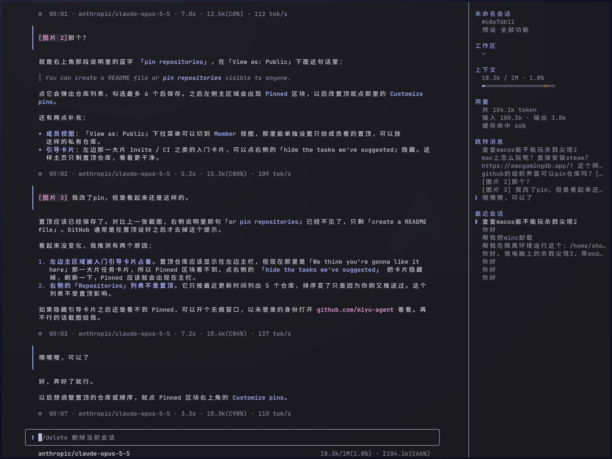

# 界面和按键

> <sub>本文档由 Anthropic 的 Claude Fable 5.2 生成。</sub>

这一页介绍 LiteMiyu 全屏界面上的各个区域，以及键盘、鼠标的用法。在界面里随时可以运行 `/help` 查看按键和命令的列表。



## 界面上的区域

### 正文

窗口的大部分是正文，从上往下是你和 AI 说过的话：

- 你说的话左边有一条竖线。
- AI 做的每一步（思考、运行命令、读写文件）叫做时间线。进行中的步骤会实时显示，回答完成后折叠成一行，例如 `查看项目结构 · 1 tool · 1s`。用鼠标点击这一行可以展开。
- AI 的回答按 Markdown 排版：标题、列表、表格、代码着色和链接都会排好。数学公式会转成 Unicode 字符显示。
- 每一轮结束后有一行小字，例如 `▣  14:18 · deepseek/deepseek-chat · 1.4s · 6.5k(C62%) · 286 tok/s`，依次是结束的时间、供应商和模型、用时、这一轮用的 token（括号里是缓存命中率）、输出速度。被你打断的一轮，这一行只写 `▣  已中断`。

正文比窗口长时，用 `PgUp`、`PgDn` 或者鼠标滚轮滚动。往上滚动之后，底部会出现 `跳转到底部（Ctrl+End）↓`。

往上滚动时，如果你正在看的这一段回答对应的那句话已经滚出了窗口，正文最上面会固定显示这句话的第一行，下面空一行，这样可以随时知道眼前的内容是在回答哪一句。点击这一行可以跳回那句话。

AI 的回答比窗口长时，正文会停在这段回答的开头（留出最上面两行），不会一直跟着滚到底，方便你从头开始读。

### 输入框

输入框在正文下面。空着的时候会显示一条灰色的小提示，每次不一样，是一些按键的用法。会话有名字时，名字显示在输入框的右上角。

输入框里有三种特殊的开头：

- 以 `/` 开头：打开命令列表，见[命令](commands.md)。
- 以 `!` 开头：输入框变成 `! 输入要跑的命令`，按 `Enter` 后直接运行这条命令，不经过 AI 决定。命令和它的输出会显示在正文里，同时交给 AI 看，AI 会接着回应。命令最长运行 120 秒。
- 其他：照常发给 AI。`@` 没有特殊含义。

### 底栏

输入框下面的一行。例如：

```text
deepseek-chat deepseek                    2.4k/128k(1.9%) · Σ8.9k(C69%) · $0.42
```

- 左边是当前的模型，后面灰色的字是供应商。模型有可选的思考程度时也显示在这里。
- 右边第一段 `2.4k/128k(1.9%)` 是上下文：最近一次请求占了多少 token、模型的上下文窗口有多大、占了百分之几。LiteMiyu 不知道这个模型的窗口大小时，只显示前面的数字。
- 第二段 `Σ8.9k(C69%)` 是这个会话累计用的 token，括号里是缓存命中率。
- 第三段是这个会话一共花了多少钱，子代理的花费也算在内。模型没有价格信息时不显示这一段；本机运行的模型价格按 0 计算。
- 有后台命令在运行时，中间会显示 `1 个后台命令`。

窗口太窄放不下时，右边的几段会从后往前省略。上下文超出窗口时，这里会显示 `上下文超出窗口` 和一个可以点击的 `压缩`。

### 侧边栏

窗口宽度在 120 列以上，并且已经开始对话时，右边会出现侧边栏。从上往下是：

| 段落 | 内容 |
|---|---|
| 会话 | 会话的名字和短编号（例如 `#f991af35`） |
| `工作区` | AI 工作的目录 |
| `上下文` | 已用和窗口大小，下面是一条进度条 |
| `用量` | 累计的 token、输入和输出各多少、缓存命中率、花费 |
| `跳转消息` | 这个会话里你说过的话，点击一句可以跳过去 |
| `文件修改` | 这个会话里 AI 修改过的文件和增删的行数，点击一行可以查看差异。没有修改过文件时不显示 |
| `最近会话` | 最近的几个会话，点击一行可以切换过去 |

窗口变窄时侧边栏会自动收起。侧边栏的内容比窗口高时，把鼠标停在侧边栏上滚动滚轮就可以滚动它。`跳转消息` 和 `最近会话` 各显示几条可以在设置里修改，见[配置](config.md)。

### 文件修改

点击侧边栏 `文件修改` 里的一行，或者运行 `/files`，会打开整屏的 `文件修改` 页：

- 窗口够宽时，左边是选中的文件的差异，右边是完整的文件列表；窗口窄时列表在上面。
- 同一个文件被修改了几次时，几次的差异按照先后接在一起，中间用一条细线隔开。
- `↑`、`↓`（或者 `j`、`k`）切换文件，`PgUp`、`PgDn` 或者鼠标滚轮滚动差异，点击列表里的一行可以直接切换过去，`Esc`（或者 `q`）返回会话。

> 这里只统计 AI 用编辑、写入工具修改的文件，不包括它运行命令修改的文件。差异是根据工具调用的内容算出来的：写入的文件整份显示为新增，编辑的片段不带行号。撤销的那几轮里的修改不会列出来。

### 子代理状态行

AI 派出子代理以后，输入框下面会多出几行，第一行是 `主会话`，下面每个子代理一行，显示它的名字、状态（`思考中`、`回答中`、`完成`）和用时。详细的见[子代理、跨会话消息和循环](agents.md)。

## 按键

### 输入和发送

| 按键 | 作用 |
|---|---|
| `Enter` | 发送；列表打开时执行选中的那一项 |
| `Shift+Enter`、`Ctrl+J` | 换行（也可以用 `Alt+Enter`） |
| `↑` `↓` | 光标在第一行、最后一行时翻看以前输入过的话 |
| `Ctrl+R` | 打开输入历史列表 |
| `Ctrl+A` | 回到输入框开头 |
| `Ctrl+←` `Ctrl+→` | 按词移动 |
| `Ctrl+W`、`Alt+Backspace` | 删除前一个词 |
| `Ctrl+G` | 用外部编辑器写这一句（使用 `$VISUAL`、`$EDITOR`） |
| `Ctrl+S` | 把输入框里的内容暂存起来，再按一次取回 |
| `Ctrl+V` | 粘贴 |

### 回答过程中

AI 回答的时候你可以继续打字、按 `Enter`，这些话会排队，等这一轮结束再发出去。排着队的话可以点击撤回。

| 按键 | 作用 |
|---|---|
| `Esc` `Esc` | 打断这一轮，并且把排队的话发出去 |
| `Ctrl+C` | 打断这一轮 |
| `Ctrl+Enter` | 不等这一轮结束，立即把排队的话（包括输入框里的）发出去 |

如果打断的时候 AI 还什么都没有做，你刚才那句话会回到输入框里，可以修改之后重新发送。

### 浏览和其他

| 按键 | 作用 |
|---|---|
| `PgUp` `PgDn` | 滚动正文 |
| `Ctrl+End` | 跳到正文底部 |
| `↓`（输入框为空时） | 把焦点移到后台命令按钮、子代理状态行，`Enter` 打开 |
| `Ctrl+C` | 有选中的文字时复制；否则清空输入框（按 `↑` 可以恢复） |
| `Ctrl+L` | 清屏 |
| `Ctrl+Z` | 挂起 LiteMiyu 回到 shell，运行 `fg` 恢复 |
| `Ctrl+D` | 输入框为空时退出 |

## 按键模式：Vim 和方向键

按键模式决定各种列表里怎么移动和搜索。默认是 `Vim`，可以在 `/config` 的 `通用` 页最下面的 `按键模式` 里切换成 `方向键`，立即生效。

| 地方 | `Vim` | `方向键` |
|---|---|---|
| 会话列表、`/model`、`/jump`、`Ctrl+R` 历史 | `j`、`k` 移动；按 `/` 开始搜索，搜索时 `Enter` 完成、`Esc` 取消 | `↑`、`↓` 移动；直接打字就是搜索 |
| 命令列表 | `Ctrl+J`、`Ctrl+K` 移动 | `↑`、`↓` 移动 |
| `/help`、`/status`、`/effort`、后台面板、确认框 | `j`、`k` 和 `↑`、`↓` 都可以 | `j`、`k` 和 `↑`、`↓` 都可以 |

> `Vim` 模式只改变列表里的操作。输入框没有“普通”“插入”两种状态，`j`、`k` 在输入框里就是普通的字母。

每个列表的底边都写着当前可以用的按键，例如 `/ 搜索 · j/k 选择 · Enter 切换 · Esc 关闭`，忘记了看一眼就可以了。

## 鼠标

LiteMiyu 全屏运行时会接管鼠标：

- 滚轮：滚动正文。鼠标停在侧边栏上时滚动侧边栏。
- 拖动：选中正文或者侧边栏里的文字，松开鼠标就复制到剪贴板，并提示 `已复制 32 个字符`。按 `Ctrl+C` 可以再复制一次，`Esc` 取消选中。
- 点击：折叠的时间线点击展开；侧边栏的短编号点击复制完整的会话编号；`跳转消息`、`最近会话` 点击跳转；`文件修改` 点击查看差异；正文顶上固定的那句话点击跳回去；底栏的 `1 个后台命令` 点击打开后台面板；回答里的链接和文件路径点击用系统的程序打开。

> 因为鼠标被 LiteMiyu 接管，终端自己的选择功能用不了。大多数终端按住 `Shift` 再拖动可以临时用回终端自己的选择。

## 复制和粘贴

复制是让终端代为写入系统剪贴板（OSC 52），所以经过 SSH 连接远程机器时也能复制到本机。如果复制之后剪贴板里没有内容，说明你的终端不支持或者没有开启这个功能，需要查看终端的文档。

粘贴有两种方式：

- 终端自己的粘贴（一般是 `Ctrl+Shift+V`）：任何情况下都可以用。
- `Ctrl+V`：LiteMiyu 自己读取系统剪贴板。Linux 和 BSD 上需要装有 `wl-paste`（Wayland）或者 `xclip`、`xsel`（X11），macOS 使用系统自带的 `pbpaste`。读不到时会提示 `无法读取剪贴板：请使用终端的粘贴（kitty 为 Ctrl+Shift+V）`。

粘贴的内容比较长时，输入框里会收成一个块，例如 `[已粘贴 14 行]`，发送时发出去的是全文。

### 粘贴文件

在文件管理器里复制文件或者文件夹，回到输入框按 `Ctrl+V`，它们会变成文件块，例如 `[main.rs]`、`[src/]`。发送时文件的路径会写进这句话里，AI 需要时自己去读。

> 粘贴文件只支持 Linux 和 BSD。macOS 上可以直接把路径打进去，或者用 `litemiyu ask --file`，见[命令行](cli.md)。

## 图标

界面默认使用 Nerd Font 的图标。如果你的终端字体不带这些图标，显示成方块或者乱码，运行 `/icons` 可以切换成普通字符，再运行一次切换回来。
