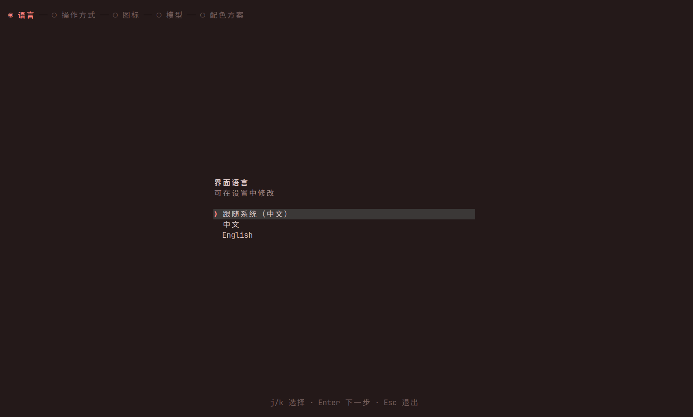
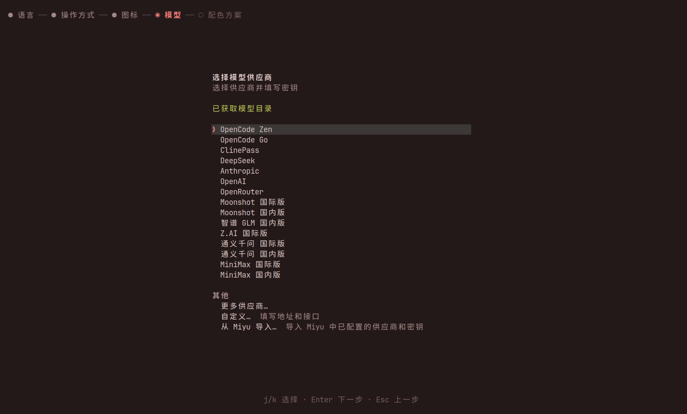

# 快速上手

> <sub>本文档由 Anthropic 的 Claude Fable 5.2 生成。</sub>

这一页带你装上 LiteMiyu、走完第一次启动的引导、发出第一句话，再介绍几件最常用的事。跟着从上到下做一遍即可。


## 安装

LiteMiyu 只有一个程序文件 `litemiyu`，放进 `PATH` 就算装好了。支持 Linux、macOS 和 BSD；Windows 上可以在 WSL2 里使用 Linux 的版本。

> 发行包还没有公开发布。下面写的是发布以后的安装方法；现在想用的话，请看[从源码编译](install.md#从源码编译)。

- Arch Linux：推荐从 AUR 安装，运行 `paru -S litemiyu-bin`。
- 其他 Linux 发行版、macOS（Apple 芯片）：到[发行版页面](https://github.com/miyu-agent/litemiyu/releases)下载对应系统的压缩包，解压后把里面的 `litemiyu` 放进 `~/.local/bin`。
- Intel 芯片的 Mac、BSD：没有发行包，需要从源码编译。

每种装法的完整步骤、校验方法、升级和卸载见[安装、升级、卸载](install.md)。

安装完成后运行：

```bash
litemiyu --version
```

输出 `litemiyu <版本>` 说明安装成功。

## 第一次启动

LiteMiyu 是在哪个目录启动的，AI 就在哪个目录里工作。所以先进入你的项目目录，再运行 `litemiyu`：

```bash
cd ~/src/project
litemiyu
```

第一次启动时还没有配置，LiteMiyu 会进入首次引导。屏幕最上面一行是进度：`语言`、`操作方式`、`图标`、`模型`、`配色方案`。每一步都用 `j`、`k` 或者方向键选择，`Enter` 进入下一步，`Esc` 回到上一步。



### 界面语言

选择界面用中文还是英文显示。第一项 `跟随系统` 会按照系统的语言环境自动决定，一般保持默认就可以了。

### 你喜欢的操作方式

这一步决定在各种列表里怎么移动和搜索：

- `Vim`：`j`、`k` 上下移动，按 `/` 开始搜索。这是默认选项。
- `方向键`：`↑`、`↓` 上下移动，直接打字就是搜索。

如果你没用过 Vim，选 `方向键` 会更顺手。这个选项只影响列表，输入框里打字不受影响。

### 图标

屏幕上会显示一行示例图标，并且问你 `你看到的是图标，还是方块或乱码？`。如果看到的是正常的图标，选 `图标`；如果是方块或乱码，说明终端的字体不是 Nerd Font，选 `方块或乱码`，界面会改用普通字符。

### 选择模型供应商

这一步给 LiteMiyu 接上一家 AI 供应商。LiteMiyu 会先联网取一份模型目录（来自 models.dev），取到以后列出常见的供应商：



1. 选择供应商

    在列表里选中你有密钥的那一家，按 `Enter`。列表里没有的话，`更多供应商…` 里可以搜索全部供应商；如果是自己搭的或者公司内部的服务，选 `自定义…`，手动填写地址和接口。

    > 如果这台电脑上装过 Miyu，列表最下面还会有一项 `从 Miyu 导入…`，可以把 Miyu 里已经配置好的供应商和密钥直接拿过来用。

2. 填写密钥

    在 `密钥` 一行按 `Enter`，粘贴供应商给你的 API 密钥，再按 `Enter` 完成。密钥只保存在你自己电脑上的 `~/.config/litemiyu/secrets.toml` 里，这个文件只有你能读取。

3. 测试连接

    选中 `测试连接 →` 按 `Enter`。连接成功会显示 `✓ 连接成功，找到 2 个模型` 这样的提示，并且列出这家供应商的模型；如果失败，会显示原因，例如 `连接失败（获取模型列表）：密钥无效或没有权限（HTTP 401）`，改正之后再测试一次就可以了。

4. 选择模型

    在模型列表里选一个作为默认模型，按 `Enter`。模型很多的时候可以按 `/` 搜索。

没有网络、取不到模型目录的情况下，列表里只有 `更多供应商…` 和 `自定义…`，此时选 `自定义…` 手动填写即可。详细的见[模型和供应商](models.md)。

### 配色方案

LiteMiyu 的颜色是跟着终端走的。这一步可以选择 `明暗`（`自动`、`深色`、`浅色`）和要不要 `背景填充`，改动会立即显示出来，选好之后选中 `下一步 →` 按 `Enter`。

最后一屏显示 `完成` 和你选的模型，按 `Enter` 开始对话。

> 以上每一项以后都可以在设置里修改，在输入框里运行 `/config` 即可。

## 发出第一句话

引导结束后会看到一个输入框，下面是当前的模型和工作目录：


直接打字，按 `Enter` 发送。例如：

```text
看一下这个项目的结构，告诉我怎么跑测试
```

AI 会自己去读文件、运行命令，过程显示在回答上方，做完以后折叠成一行；回答里的表格、代码都会排好版显示。输入框下面的一行叫底栏，左边是模型，右边是这个会话已经用了多少上下文和 token。

AI 平常读写文件、运行命令不会问你。只有遇到 `git push --force` 这类高危命令时才会弹出确认框，由你决定是否允许。详细的见[工具和权限](tools.md)。

## 最常用的几件事

- 换行：`Shift+Enter` 或者 `Ctrl+J`。
- 打断 AI：回答过程中连按两次 `Esc`。
- 使用命令：在输入框里输入 `/` 会打开命令列表，例如 `/new` 开一个新会话，`/model` 换模型，`/help` 查看全部按键和命令。全部命令见[命令](commands.md)。
- 自己运行一条命令：以 `!` 开头，例如 `!git status`。命令会直接运行，输出也会交给 AI 看。
- 撤回：AI 答偏了可以运行 `/undo` 撤回上一轮，你说的那句话会回到输入框里，改一改再发。
- 回到以前的会话：`/sessions` 列出所有会话；或者启动时运行 `litemiyu -c` 直接打开最近的会话。
- 退出：输入框为空时按 `Ctrl+D`，或者运行 `/exit`。

## 接下来看什么

- 想熟悉界面上各个区域和全部按键，可以看：[界面和按键](interface.md)。
- 想添加更多供应商、换默认模型，可以看：[模型和供应商](models.md)。
- 想在脚本里调用 LiteMiyu，可以看：[命令行](cli.md)。
- 完整的文档目录在[这里](../README.md)。
