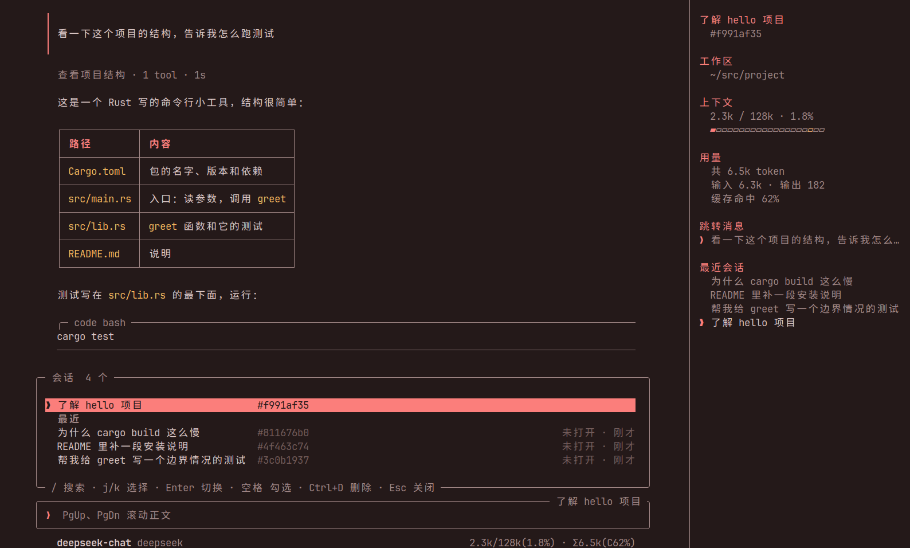

# 会话

> <sub>本文档由 Anthropic 的 Claude Fable 5.2 生成。</sub>

“会话”是你和 AI 的一段连续的对话。每个会话都保存在磁盘上，关掉窗口以后可以随时回来接着聊。这一页是新建、继续、整理会话的方法，以及会话变长以后 LiteMiyu 会做什么。

## 新建会话

- 运行 `litemiyu` 启动时就是一个新会话。发出第一句话之前它不会保存到磁盘。
- 在界面里运行 `/new` 开一个新会话，原来的会话保留在磁盘上。

会话的工作目录是启动 LiteMiyu 时所在的目录，会话建好以后不会改变。想让 AI 在另一个项目里工作，就到那个目录里重新启动 LiteMiyu。

### 会话的预设

每个会话使用一个预设，预设决定这个会话可以使用哪些内置工具、MCP 服务和技能。LiteMiyu 自带两个预设：

| | 全部功能 | 无功能 |
|---|---|---|
| 怎么开 | `/new`、`litemiyu`（没有修改默认预设时） | `/new bare`、`litemiyu --bare` |
| 工具 | 全部 | 没有 |
| 自动加入对话的内容 | 时间、工作目录、项目说明、技能列表、记忆等 | 什么都不加 |
| 适合 | 让 AI 做事 | 只想和模型聊天、问问题 |

你也可以定义自己的预设，例如只打开 `shell` 和 `jobs` 两个工具，然后用 `/new <预设名>`、`litemiyu --preset <预设名>` 或者 `/preset` 选择它。

会话发出第一个请求以后，它的预设就固定了，中途不能更换，想换就新建一个会话。侧边栏的会话信息里始终显示当前会话的预设。详细的见[预设](presets.md)。

## 继续以前的会话

启动时：

```bash
litemiyu -c             # 打开最近的会话
litemiyu -s <编号>      # 打开指定的会话
```

`-s` 后面要写完整的会话编号，例如 `01a1f757-91fc-74f7-b69f-b1c414c7090c`。完整的编号可以在 `/status` 里看到，也可以点击侧边栏里的短编号复制。

在界面里：运行 `/sessions`，或者点击侧边栏 `最近会话` 里的一行。

> 同一个会话同一时间只能在一个窗口里打开。如果它已经在别的窗口开着，会提示 `会话 … 已在其他窗口打开`。不同的会话可以同时开在不同的窗口里。

在同一个窗口里切换到别的会话（`/sessions`、侧边栏的 `最近会话`、`/new`）时，原来的会话如果还在工作，会留在后台继续运行：正在进行的这一轮、后台命令、子代理、循环和定时触发都不会停。切换回去就能看到它现在的进度。它已经空闲时，切走以后会被关闭，下次切换回去再打开。留在后台的会话可以被别的窗口直接打开：它会从这个窗口的后台转到那个窗口，正在进行的这一轮在那个窗口里继续，正文里多一行 `已暂停，重新打开后继续`。只有正显示在某个窗口里的会话，别的窗口才打不开，会提示 `会话 … 已在其他窗口打开`。退出 LiteMiyu 时，后台的会话一起停止，下次打开时接着做没有做完的那一轮。

## 会话列表

运行 `/sessions`（或者 `/resume`）打开会话列表：



第一行是当前的会话，下面按 `最近`、`近 7 天`、`近 30 天`、`30 天前` 分组。每一行是会话的名字、短编号、状态和上次使用的时间。没有起名的会话显示它的第一句话；用 `litemiyu ask` 产生的会话、在编辑器里开的对话（见[在编辑器里使用](acp.md)）也在这里。

状态有四种：`未打开`、`在后台运行中`（在这个窗口的后台）、`已在其他窗口打开`、`在其他窗口运行中`。

| 按键（`Vim` 模式） | 作用 |
|---|---|
| `j` `k` | 上下移动 |
| `/` | 搜索，搜索时 `Enter` 完成、`Esc` 取消 |
| `Enter` | 切换到选中的会话 |
| 空格 | 勾选，可以勾选多个 |
| `Ctrl+D` | 删除选中的或者勾选的会话，需要再按一次确认 |
| `Esc` | 关闭列表 |

`方向键` 模式下用 `↑`、`↓` 移动，直接打字搜索。

## 给会话起名

LiteMiyu 不会自动给会话起名。运行 `/rename 名字` 自己起一个，或者只运行 `/rename` 让 AI 起一个。名字显示在输入框的右上角、侧边栏和会话列表里。

## 在会话里找以前的内容

- `/jump`：列出这个会话里你说过的每一句话，选一句跳过去。侧边栏的 `跳转消息` 是它的快捷方式。
- `/files`：查看这个会话里 AI 修改过的文件和差异。侧边栏的 `文件修改` 是它的快捷方式。
- `Ctrl+R`：列出你输入过的话（所有会话的都在里面），选一条填回输入框。

## 撤回和恢复

| 命令 | 作用 |
|---|---|
| `/undo` | 撤回上一轮，你说的那句话回到输入框。可以连续撤回 |
| `/restore` | 恢复刚才撤回的一轮 |
| `/redo` | 用同一句话让 AI 把最后一轮重新做一遍 |
| `/edit` | 修改你说的上一句话，再重来这一轮 |

撤回之后正文里会留一行 `↶ 已撤回 · /restore 恢复`。

> 撤回只对对话有效。AI 已经修改的文件、已经运行的命令不会还原。

## 导出

运行 `/export`，会话会导出成一个 Markdown 文件，放在启动 LiteMiyu 时所在的目录里，文件名是 `litemiyu-session-<短编号>.md`。文件的样子：

```markdown
# 我的第一个会话

## 你

你好

## 回答

好的，收到。
```

## 删除

- 删除当前的会话：运行 `/delete`。不会询问确认。
- 删除其他会话：在会话列表里选中或者用空格勾选几个，按 `Ctrl+D`。底边会提示 `再按一次 Ctrl+D 删除 2 个会话`，再按一次才真的删除。

删除的会话无法恢复。删除一个会话时，它派出的子代理的会话会一起删除。

## 长会话和压缩

模型一次能处理的内容是有限的，这个上限叫做“上下文窗口”。对话越来越长，总有装不下的时候。LiteMiyu 的做法是“压缩”：让模型把较早的对话写成一段摘要，用摘要代替原文，最近的内容原样保留。

- **自动压缩**：上下文用到窗口的 85% 左右时自动进行。完成后正文里显示一行 `● 上下文已压缩：17.3k → 1.7k token`。运行 `/status` 可以看到压缩过几次，以及下一次到多少会压缩，例如 `1 次 · 到 9.4k 自动压缩`。
- **手动压缩**：运行 `/compact`，后面可以写对摘要的要求。
- **预压缩**：上下文快满的时候，LiteMiyu 会在后台提前准备好摘要，到时候直接换上，不用停下来等。

压缩之后：

- 正文里以前的内容还在，往上滚动可以看到，`/jump` 也照样可用。压缩只影响发给模型的内容。
- AI 需要压缩前的细节时，可以用 `history` 工具去会话记录里查。
- 压缩错了可以运行 `/undo` 撤回，提示 `已撤回压缩，上下文恢复到压缩前`。

触发线和预压缩可以在 `/config` 的 `高级` 页调整，见[配置](config.md)。如果 LiteMiyu 不知道模型的窗口大小，就不会自动压缩，见[模型和供应商](models.md#不知道上下文窗口的时候)。

> 如果一件事已经做完，接下来要做的事和之前无关，运行 `/clear` 清空上下文或者 `/new` 开一个新会话，比一直在同一个会话里聊下去更省 token，AI 也不容易被旧的内容干扰。

## 会话打不开的时候

- 提示 `会话暂时无法读取，5 秒后自动重试`：读取会话文件时出错了。LiteMiyu 会自动重试几次，都失败之后提示 `会话暂时无法读取，请稍后重试`。
- 提示 `会话日志第 … 行已损坏，只能查看这一行之前的内容。如果要继续，请新建会话。`：会话文件中间损坏了。这个会话会以只读方式打开，可以查看损坏之前的内容，继续工作需要运行 `/new`。
