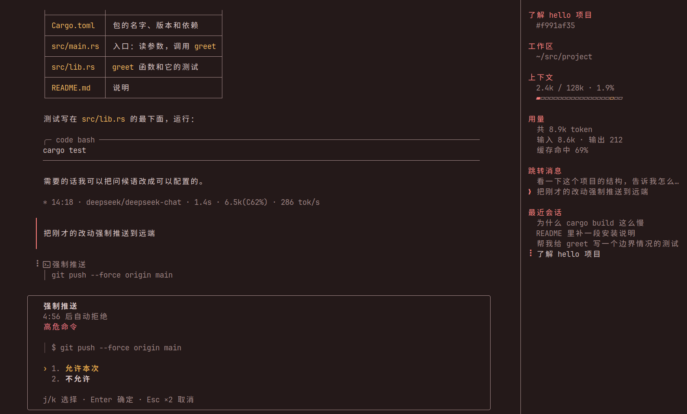

# 工具和权限

> <sub>本文档由 Anthropic 的 Claude Fable 5.2 生成。</sub>

AI 能读写文件、运行命令，靠的是 LiteMiyu 给它的“工具”。这一页介绍 AI 手上有哪些工具，哪些操作会先问你，哪些操作永远不会执行。

## AI 能用的工具

LiteMiyu 自带 12 件工具，全部编在程序里，不需要安装：

| 工具 | 作用 |
|---|---|
| `read` | 读一个文本文件、一张图片，或者列出一个目录 |
| `write` | 新建一个文件，或者整个替换一个文件的内容 |
| `edit` | 按原文替换文件里的文字，一次可以改几处 |
| `shell` | 运行一条命令并取回输出；可以放到后台运行 |
| `jobs` | 列出后台命令和子代理、读后台命令的输出、停掉其中一个 |
| `subagent` | 另开一个子会话，在后台做一件事 |
| `send_message` | 给子代理、上一级或者别的会话发消息 |
| `sessions` | 列出你的其他会话 |
| `session_usage` | 查看这个会话用了多少 token、上下文有多满 |
| `history` | 搜索、读回这个会话前面的内容，包括被压缩掉的部分 |
| `ask_user` | 向你提几个带选项的问题，等你回答 |
| `schedule_wakeup` | 给这个会话定一个时间，到点以后自己继续；在 AI 自己定节奏的 `/loop` 里，用它决定下一次什么时候执行。见[定时触发](agents.md#定时触发) |

除此之外，你接入的 MCP 服务提供的工具也会交给 AI，见[技能和 MCP](skills-mcp.md)。

LiteMiyu 没有专门的搜索文件、抓取网页、回收站工具。AI 需要搜索时会用 `shell` 运行 `grep`、`find`，需要上网时运行 `curl`，删除文件用 `rm`。

> 删除的文件不会进回收站。重要的项目建议放在 `git` 里，AI 改错了可以找回来。

不同的会话能用的工具不同，由会话的[预设](presets.md)决定：

| 会话 | 工具 |
|---|---|
| `全部功能` 预设（默认） | 12 件全部可用，加上 MCP 的工具 |
| `无功能` 预设（`/new bare`、`litemiyu --bare`） | 没有任何工具 |
| 自己定义的预设 | 预设里打开的那几件，加上预设里打开的 MCP 服务的工具 |
| 应急模式（`litemiyu --rescue`） | 只有 `read`、`write`、`edit`、`shell`、`jobs`、`schedule_wakeup`、`ask_user` |
| 子代理 | 没有 `ask_user`、`sessions` 和 `schedule_wakeup` |

## 权限：默认不询问

LiteMiyu 没有沙盒，也没有权限级别。AI 读写文件、运行命令时不会一步一步问你，命令以你的用户身份直接运行，能做你在终端里能做的任何事。

这样用起来很顺，但是模型偶尔会出错，所以 LiteMiyu 保留了三道拦截，下面依次说明。

> 如果你需要更严格的隔离，建议在容器、虚拟机里，或者用一个单独的系统用户运行 LiteMiyu。

## 会先问你的操作：高危命令

AI 要运行下面这几类命令时，LiteMiyu 会先弹出确认框：

| 类别 | 例子 |
|---|---|
| 改写远端的 git 历史 | `git push --force` |
| 丢弃本地的改动 | `git reset --hard`、`git clean -f`、`git checkout -- .`、`git restore .`、`git stash drop` |
| 删除工作目录本身或者它的上级目录 | `rm -rf .` |
| 递归删除，但是目标要运行时才知道 | `rm -rf "$DIR"` |
| 关机、重启 | `shutdown`、`reboot` |
| 下载之后直接执行 | `curl … \| sh` |
| 让容器拿到宿主机的设备或者命名空间 | `docker run --device …`、`--pid host` |

LiteMiyu 是按命令的字面来判断的，并且会看穿 `sudo`、`env`、`sh -c` 这类外壳。



确认框里写着 AI 给这一步起的标题、`高危命令` 的标记和完整的命令。用 `j`、`k` 选择，`Enter` 确定：

- `允许本次`：运行这一条命令。只对这一次有效，下次遇到还会再问。
- `不允许`：不运行。选中这一项时可以按 `n` 写一句理由，AI 会看到这句理由，据此换一种做法。

连按两次 `Esc` 也是拒绝。

确认框左上角有一个倒计时，例如 `4:56 后自动拒绝`。默认等待 300 秒，超时没有回答就当作拒绝，这样你不在电脑前的时候 AI 不会一直卡着。等待的时间可以在 `/config` 的 `通用` 页修改 `确认超时`，设成 `0` 表示一直等待。

## 永远被拦下的操作

下面这些命令一旦执行就无法挽回，所以 LiteMiyu 直接拒绝，不会询问，你也没有办法在界面里放行：

- 删除根目录，例如 `rm -rf /`。
- 删除你的家目录或者它的上级目录。
- 删除根目录下的系统目录，例如 `/usr`、`/etc`、`/home`。
- 删除、移走 LiteMiyu 自己的数据目录，或者把它移到回收站。
- 格式化磁盘：`mkfs`、`wipefs`。
- 直接写磁盘设备：`dd of=/dev/…`。
- 把整个宿主机交给容器：`docker run --privileged`、把 `/` 挂进容器等。

被拦下以后，AI 会收到一句说明（例如这条命令会删除根目录，所以没有执行），然后继续做别的。如果你确实需要运行这样的命令，请自己在终端里运行。

## LiteMiyu 自己的数据

AI 的工具不能读取、也不能修改 LiteMiyu 自己的数据目录，包括配置文件、密钥文件和会话记录。这是为了防止 AI 读到你的密钥，或者改坏配置。

有两个文件夹是例外，AI 可以读写：

- 记忆的文件夹，见[提示词、项目说明和记忆](memory.md)。
- 你放技能的文件夹，见[技能和 MCP](skills-mcp.md)。

## AI 向你提问

AI 拿不准的时候可以用 `ask_user` 向你提问。问题和选项显示在输入框的位置：

```text
用哪种数据库？

› 1. SQLite (Recommended)
     单文件，不用另装服务
  2. PostgreSQL
     要另装服务
  3. 输入其他答案

j/k 选择 · Enter 提交 · n 补充 · Esc ×2 取消
```

用 `j`、`k` 选择，`Enter` 提交。选项都不合适时选 `输入其他答案` 自己写；按 `n` 可以在选项之外补充一句话。可以多选的问题用空格勾选；一次问了几个问题时，用 `←`、`→` 换题。

提问没有时间限制，会一直等你回答。

## 在命令行里使用时

`litemiyu ask` 运行的时候没有人可以回答确认框，所以需要确认的高危命令会被直接拒绝，结束时的退出状态是 4。确实要放行的话可以加 `--yes`。永远被拦下的那些操作加了 `--yes` 也照样拒绝。见[命令行](cli.md#高危命令和---yes)。
